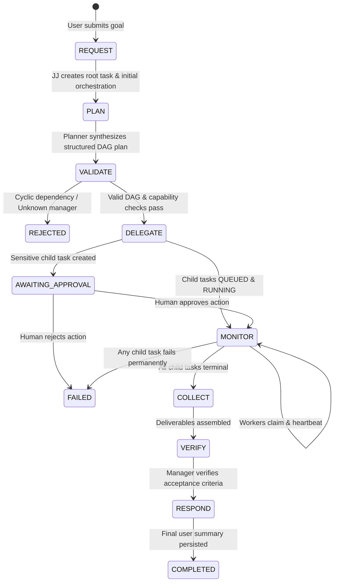

# JJ Orchestrator Architecture & Lifecycle Specification

## 1. Overview & Role

**JJ** is the top-level Chief of Staff and autonomous orchestrator of Griffin.

Griffin operates not as a collection of disjoint chatbots, but as a structured, hierarchical AI workforce. When a user submits an objective, JJ:
1. Interprets intent and extracts context.
2. Formulates a structured execution plan represented as a Directed Acyclic Graph (DAG).
3. Assigns work to one of 11 domain specialist managers.
4. Validates the plan against governance rules, cycle constraints, and capability boundaries.
5. Delegates work by instantiating durable child tasks in the PostgreSQL task engine with explicit dependencies and approval checkpoints.
6. Monitors execution progress, collects deliverables, verifies outputs against manager acceptance criteria, and synthesizes a final response.
7. Guarantees process restart recovery (`ReconcileInFlight`) if the server or runner restarts during execution.

---

## 2. The 8-Stage Orchestration Lifecycle

Every user request follows an explicit state progression managed by `JJOrchestrator`:



### Lifecycle Stage Breakdown

| Stage | Method / Component | Description |
| :--- | :--- | :--- |
| **1. REQUEST** | `SubmitRequest` | Ingests `UserRequest` (`RequestText`, `Priority`, `Context`). Creates a root task in `tasks` with `manager_domain = 'JJ'` and `status = 'RUNNING'`, leased by `JJ_ORCHESTRATOR`. |
| **2. PLAN** | `Planner.GeneratePlan` | Produces `PlanPayload` containing objective, domain manager classification, and array of child task definitions with prerequisite keys and capability requirements. |
| **3. VALIDATE** | `domain.ValidatePlan` | Validates the plan against governance boundaries: detects cycles using Kahn's algorithm, verifies designated manager exists in registry, and enforces approval flags on sensitive capabilities. |
| **4. DELEGATE** | `delegatePlan` | Instantiates child tasks in `tasks` table. Links prerequisite UUIDs in `task_dependencies`. If a specialist worker is specified, queries `AgentFactory` to inherit worker prompts and schemas. Registers `approvals` if sensitive capabilities are requested. |
| **5. MONITOR** | `ReconcileOrchestration` | Monitors in-flight execution of child tasks. Workers claim child tasks via PostgreSQL `SKIP LOCKED`. JJ polls or reconciles task states without blocking worker leases. |
| **6. COLLECT** | `ReconcileOrchestration` | Gathers child deliverables, output payloads, and execution telemetry when child tasks complete. |
| **7. VERIFY** | `Manager.VerifyDeliverable` | Designated domain manager inspects each child task output against predefined verification rules. |
| **8. RESPOND** | `ReconcileOrchestration` | Synthesizes final response for the user, updates orchestration status to `COMPLETED`, records output in root task, and releases lease. |

---

## 3. Plan Generation & Validation

### Planner Architecture (`internal/service/planner.go`)
- **`AIPlanner`**: Invokes the configured execution engine (Antigravity CLI or MockExecutor) with a strict JSON schema (`PlanPayloadSchema`) to produce structured DAG decomposition.
- **`RuleBasedPlanner`**: Fallback deterministic planner classifying requests into domain managers based on heuristic keyword matching and generating default staged inspection/execution pipelines.
- **Decoupled `PlanExecutor` Interface**: To prevent circular package dependencies between `service` and `worker`, `service.Planner` consumes `service.PlanExecutor`, adapted via `internal/worker/plan_adapter.go`.

### Kahn's Algorithm DAG Cycle Detection
In `internal/domain/orchestration.go`, `ValidatePlan` validates DAG integrity before any tasks are created:
1. Calculates in-degree for each child task based on `Prerequisites`.
2. Verifies all prerequisites point to valid keys defined within the same plan.
3. Initializes a queue with all nodes having zero in-degree.
4. Iteratively dequeues nodes, decrementing dependent neighbor in-degrees.
5. If processed node count does not equal total nodes, a cycle is detected and the plan is rejected (`domain.PlanStatusRejected`).

---

## 4. Child Task Delegation & Root Aggregation

### Root vs Child Tasks
- **Root Task**: Represents the entire user request. Its `manager_domain` is `'JJ'`, and its status reflects the orchestration state (`RUNNING` $\rightarrow$ `COMPLETED` / `FAILED`).
- **Child Tasks**: Represent individual operational units assigned to specialist managers (e.g. `engineering`, `research`). Each child task has `parent_id = root_id = rootTask.ID`.
- **Delegation Records**: Persisted in `delegation_records` table, linking orchestration ID, root task ID, child task ID, task key, manager ID, and worker key for end-to-end auditability.

### Database Invariant Protection
In `internal/repository/task_repo.go`, `CompleteTask` and `FailTask` queries enforce:
```sql
WHERE id = $3 AND (leased_by = $4 OR manager_domain = 'JJ') AND status IN ('RUNNING', 'VERIFYING')
```
This preserves distributed lease guarantees for worker tasks while enabling JJ to transition root orchestration tasks to terminal states upon completion or abort.

---

## 5. Process Restart Recovery (`ReconcileInFlight`)

If the Griffin server restarts or the EC2 runner reboots while orchestrations are in flight:
1. On startup, `cmd/griffin-server/main.go` calls `orchestrator.ReconcileInFlight(ctx)`.
2. Queries `orchestrations` table for active states (`PLANNING`, `RUNNING`, `AWAITING_APPROVAL`).
3. For each active orchestration, queries child task states in `tasks` table.
4. Reconciles delegation records, marks completed deliverables, aborts orchestrations if child tasks failed permanently, and completes orchestrations whose child tasks finished during downtime.
5. Zero human intervention or manual state cleanup is required.

---

## 6. REST API Endpoints

| Method | Endpoint | Description |
| :--- | :--- | :--- |
| `POST` | `/api/v1/orchestrator/requests` | Ingests a new user goal, generates plan, validates DAG, delegates tasks, and returns 201 Created. |
| `GET` | `/api/v1/orchestrator/requests/{id}` | Reconciles child task states and returns orchestration record with child delegations. |
| `GET` | `/api/v1/orchestrator/plans/{id}` | Retrieves execution plan details, DAG structure, and validation errors. |
