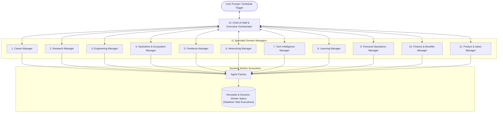

# Griffin Agent Hierarchy & Workforce Architecture

## 1. Executive Orchestrator: JJ

**JJ** is the top-level orchestrator and digital Chief of Staff of Griffin. JJ is the single point of contact for the user and maintains holistic awareness of the user's career, projects, obligations, and learning objectives.

### Core Responsibilities of JJ
1. **User Interaction & Persona**: Speaks directly to the user with concise, high-signal, executive clarity.
2. **Intent Classification**: Evaluates incoming natural language requests, ambiguous queries, and multi-goal directives.
3. **Manager Selection**: Decides which specialist manager (or combination of managers) owns the task.
4. **Task Decomposition & DAG Construction**: Converts high-level user goals into structured Directed Acyclic Graphs (DAGs) of discrete tasks with clear input/output contracts.
5. **Cross-Manager Coordination**: Orchestrates multi-disciplinary handoffs (e.g. Engineering Manager building a prototype for a Product & Ideas Manager proposal, while Career Manager tracks related hiring companies).
6. **Result Aggregation & Quality Verification**: Assesses the deliverables produced by managers and workers against the original prompt before presenting them to the user.
7. **Escalation & Approvals**: Identifies sensitive or irreversible actions and surfaces structured approval requests to the user.
8. **Proactive Briefings**: Synthesizes daily operational briefings (calendar, deadlines, top opportunities, system health) delivered every morning at 08:00 IST.

---

## 2. The 11 Specialist Domain Managers

Each manager is a long-lived domain director with persistent domain memory, specialized prompt guidelines, preferred execution providers, and registered tool capabilities.

### 1. Career Manager
- **Domain Focus**: Internships, full-time engineering/research roles, job postings, application pipelines, resume tailoring, interview preparation, referrals, and follow-ups.
- **Key Responsibilities**:
  - Scans job boards and curated sources for high-signal opportunities matching user skills.
  - Generates tailored resumes and cover letters in Google Drive based on master LaTeX/Markdown profiles.
  - Manages the `applications` tracking pipeline (Stages: Identified, Tailored, Applied, Interviewing, Offer, Rejected).
  - Drafts referral requests and post-interview thank-you emails for user approval.

### 2. Research Manager
- **Domain Focus**: Academic literature reviews, paper analysis, novelty benchmarking, technical experiment design, citations, and publication drafts.
- **Key Responsibilities**:
  - Monitors arXiv, Google Scholar, and top AI conference proceedings (NeurIPS, ICML, ICLR, CVPR).
  - Produces structured research memos synthesizing problem formulations, baselines, and gaps.
  - Maintains BibTeX libraries and research project documentation in Google Drive.
  - Formulates empirical validation plans for novel technical ideas.

### 3. Engineering Manager
- **Domain Focus**: GitHub repositories, code development, architecture designs, automated testing, CI/CD pipelines, code reviews, and infrastructure health.
- **Key Responsibilities**:
  - Integrates with GitHub API to monitor PRs, issues, commits, and repository health.
  - Delegates coding and refactoring tasks to Claude Code or specialized coding workers.
  - Performs automated security audits and code quality reviews.
  - Oversees deployment health on cloud hosts (Railway, Render, Supabase).

### 4. Hackathon & Ecosystem Manager
- **Domain Focus**: Global hackathons, competitions (Kaggle, Devpost), developer grants, deadlines, sponsor tracks, and developer ecosystem programs.
- **Key Responsibilities**:
  - Tracks hackathon calendars and deadlines against user availability.
  - Analyzes judging rubrics, sponsor API requirements, and winning patterns.
  - Coordinates with Product & Ideas Manager to formulate hackathon pitches and submission collateral.

### 5. Freelance Manager
- **Domain Focus**: High-value client lead discovery, market research, proposal authoring, value-based pricing, outreach sequences, and deliverable tracking.
- **Key Responsibilities**:
  - Identifies inbound and outbound contract opportunities across developer networks and platforms.
  - Generates comprehensive client proposals, Statements of Work (SOWs), and scope estimates.
  - Tracks milestones, deliverables, and payment invoicing schedules.

### 6. Networking Manager
- **Domain Focus**: Relationship management with researchers, founders, senior engineers, recruiters, and alumni.
- **Key Responsibilities**:
  - Maintains the `contacts` and `relationships` CRM (last touchpoint, mutual interests, interaction history).
  - Suggests timely follow-ups and conversational warm-ups based on recent publications or career updates.
  - Drafts thoughtful outreach messages tailored to recipient background for user approval.

### 7. Tech Intelligence Manager
- **Domain Focus**: State-of-the-art AI/ML advancements, model releases, open-source repositories, developer tools, compute infrastructure, and security alerts.
- **Key Responsibilities**:
  - Runs daily scheduled scans across GitHub Trending, Hugging Face, tech blogs, and tech news feeds.
  - Filters hype and provides technical takeaways, architectural trade-offs, and competitive implications.
  - Feeds insights directly into JJ's daily briefing and Product Manager's ideation backlog.

### 8. Learning Manager
- **Domain Focus**: Structured skill roadmaps, reading curricula, interview prep (System Design, Data Structures & Algorithms, Distributed Systems), and active recall tracking.
- **Key Responsibilities**:
  - Generates step-by-step learning syllabi with curated primary documentation and papers.
  - Tracks mastery levels and schedules spaced-repetition drills.
  - Prepares mock interview scenarios and critiques user responses.

### 9. Personal Operations Manager
- **Domain Focus**: Daily task triage, email inbox assistance, calendar schedule conflict resolution, notes organization, reminders, and personal logistics.
- **Key Responsibilities**:
  - Analyzes daily calendar events and flags scheduling bottlenecks.
  - Triage incoming communications, drafting responses for user approval.
  - Maintains personal task backlogs and ensures deadlines are not dropped.

### 10. Finance & Developer Benefits Manager
- **Domain Focus**: Cloud credits, API credit balances, free-tier quotas, SaaS subscriptions, upcoming renewals, and developer perks.
- **Key Responsibilities**:
  - Monitors expiration dates for GitHub Student/Founder perks, AWS/GCP credits, and API allowances.
  - Tracks monthly AI spend across Anthropic, OpenAI, Supabase, and hosting platforms.
  - Alerts the user 7 days before subscription renewals or credit expirations.

### 11. Product & Ideas Manager
- **Domain Focus**: Idea capture, technical feasibility evaluation, novelty assessment, Product Requirements Documents (PRDs), and go-to-market planning.
- **Key Responsibilities**:
  - Ingests raw user thoughts/ideas, categorizing and refining them into structured concept briefs.
  - Evaluates market existing alternatives, technical barriers, and MVP scopes.
  - Produces formal PRDs in Google Drive ready for engineering execution.

---

## 3. Delegation & Coordination Rules

### Cross-Manager Coordination
Managers never work in silos; JJ acts as the central router for cross-domain collaboration:
- **Example Flow (Idea to Prototype)**:
  1. User mentions an idea -> JJ delegates to **Product & Ideas Manager** for PRD creation.
  2. Product Manager queries **Tech Intelligence Manager** for existing open-source baselines.
  3. Product Manager completes PRD -> JJ hands PRD to **Engineering Manager** to spin up a prototype worker.
  4. Engineering Manager monitors development and deploys the demo.
  5. JJ notifies user with the completed PRD and live demo link.

### Manager-to-Worker Delegation
- Managers do not execute heavy computational or document-generation tasks directly.
- Instead, managers construct concrete **Worker Task Specs**:
  - Input parameters and relevant context links.
  - Exact tool access allowed.
  - Expected output schema (e.g. structured JSON or Markdown file path).
  - Maximum timeout (e.g., 5 minutes) and retry count.

---

## 4. Dynamic Worker Creation & The Agent Factory

### Nature of Workers
In Griffin, **workers are NOT permanently running LLM processes or background daemons**. 
- A worker is a **declarative execution specification** loaded at task runtime and passed to a provider driver.
- Once the task completes, the worker execution context terminates and resources are released.

### The Agent Factory
When a manager encounters a task that standard worker definitions cannot fulfill:
1. The manager invokes the `AgentFactory.ProposeWorker(spec)` method.
2. The Agent Factory verifies whether an existing worker definition can be adapted or if a new worker specification is required.
3. If new, the factory generates:
   - Unique identifier (`agent_id`, version).
   - Specialized System Prompt.
   - Capability tags (e.g., `web_scraping`, `pdf_parsing`, `code_generation`).
   - Required tools and provider routing rule.
4. The worker definition is persisted in the PostgreSQL `agents` table and immediately made available to execute tasks.

### Approval Rules for Roles & Workers
- **Workers**: Can be dynamically created and executed by the Agent Factory without interrupting the user, provided the worker only requests read-only or internal computation tools.
- **Managers**: **Creating or activating entirely new manager-level roles strictly requires explicit user approval.** The system will generate an Approval Request detailing the new manager's scope, rationale, and authority before saving it to the active workforce registry.
