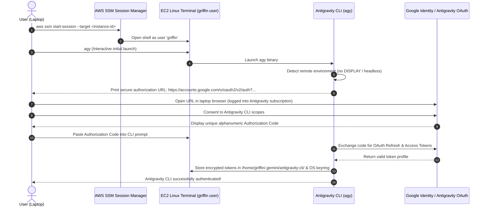

# Antigravity AWS EC2 Authentication & Credential Lifecycle Strategy

## 1. Compliance & Security Boundaries

Griffin enforces strict ethical and architectural boundaries regarding authentication:
- **No Credential Extraction or Forging**: Griffin never attempts to decompile auth binaries, reverse-engineer proprietary signing keys, or forge tokens.
- **No Unsupported Credential Copying**: Session credentials are created natively on the VM through officially documented authentication flows.
- **Dedicated Security Context**: Authentication is bound to a dedicated system user (`griffin`) on an encrypted storage volume.

---

## 2. Supported EC2 Interactive Authentication Workflows

The official Antigravity documentation (`https://antigravity.google/docs/install/#remote-ssh-oauth-flow`) defines two first-class mechanisms for authenticating headless/remote environments:

### Method 1: The Remote OAuth Loopback Flow (Primary / Recommended)

This flow is officially designed for remote terminal sessions where no local X11/Wayland display server or web browser exists:



#### Step-by-Step Execution Sequence
1. Connect to the EC2 VM securely via AWS Systems Manager:
   ```bash
   aws ssm start-session --target i-0123456789abcdef0 --region ap-south-1
   ```
2. Switch to the dedicated `griffin` user:
   ```bash
   sudo -i -u griffin
   ```
3. Run `agy`:
   ```bash
   agy
   ```
4. Copy the printed authorization URL to your local laptop browser.
5. Log in with your Google account that holds the active Antigravity subscription.
6. Copy the returned authorization code, paste it into the remote terminal, and press Enter.
7. Verify authentication:
   ```bash
   agy -p "Authentication verification test" --output-format json
   ```

---

### Method 2: Browser-Based Auth via SSM Port Forwarding (Alternative)

If a specific `agy` build runs a local HTTP callback server (e.g. `http://localhost:8085/oauth/callback`) rather than manual code entry, AWS SSM Session Manager provides secure port forwarding:

1. Initiate an SSM port forwarding session from your laptop:
   ```bash
   aws ssm start-session \
     --target i-0123456789abcdef0 \
     --document-name AWS-StartPortForwardingSession \
     --parameters '{"portNumber":["8085"],"localPortNumber":["8085"]}' \
     --region ap-south-1
   ```
2. In the remote terminal on EC2, launch `agy`.
3. The CLI triggers the local callback listener on port 8085.
4. When you authenticate in your laptop browser, the redirect to `http://localhost:8085/oauth/callback` is tunneled through SSM directly to the EC2 listener without opening any public firewall ports!

---

## 3. Persistent Storage & Headless Keyring Architecture

### 1. Encrypted Storage Volume
- The EC2 root/data volume is an **AWS EBS gp3 volume encrypted with AWS KMS** (`aws/ebs`).
- Token directory: `/home/griffin/.gemini/antigravity-cli/`
- Permissions: `0700` (`drwx------ griffin:griffin`). Files inside: `0600` (`-rw------- griffin:griffin`).

### 2. Linux Secret Service / Keyring on Headless Ubuntu
`agy` attempts to store credentials in the Linux Secret Service (via DBus / `libsecret`). On a headless EC2 instance without a GUI desktop session, DBus must be initialized for non-interactive persistence:
- Install `dbus-user-session` and `gnome-keyring`.
- Configure a PAM or auto-unlock keyring script for the `griffin` service user:
  ```bash
  # In /home/griffin/.bashrc or systemd service ExecStartPre:
  eval $(dbus-launch --sh-syntax)
  eval $(echo -n "griffin-internal-vault" | gnome-keyring-daemon --daemonize --login)
  gnome-keyring-daemon --start --components=secrets
  ```
- This ensures that when the VM reboots or the `griffin.service` starts automatically, the credential store is already unlocked and accessible to headless `agy` commands.

---

## 4. Session Expiry & Re-Authentication Monitoring

OAuth tokens consist of short-lived **access tokens** (1 hour) and a long-lived **refresh token** (typically 30–180 days, subject to account security policies).

### 1. Automatic Refresh
During normal operation, `agy` automatically handles refreshing access tokens using the cached refresh token stored on disk. No manual action is needed.

### 2. Proactive Canary Health Check
Griffin's Go backend runs a lightweight, scheduled canary check every 6 hours:
```bash
agy -p "ping" --output-format json --print-timeout 30s
```

### 3. Failure State Handling (`NEEDS_REAUTH`)
If the canary check fails with an exit code indicating token revocation or expiration (`authentication required`):
1. **Runner State Transition**: The Go backend sets `AntigravityRunnerStatus = NEEDS_REAUTH`.
2. **Queue Backpressure**: New tasks assigned to Antigravity are placed in `BLOCKED_AWAITING_PROVIDER` state. **The engine does NOT silently fall back to paid model APIs unless explicitly authorized.**
3. **High-Priority User Alert**: JJ delivers an urgent notification via Web Push and Email:
   > **[URGENT] Antigravity CLI Session Expired on EC2**
   > Your Antigravity session on EC2 requires re-authentication.
   > Quick fix: Run `aws ssm start-session --target <id>` and run `agy` to refresh credentials.
4. **Resolution**: Once the user completes the remote OAuth loop, the canary check succeeds, runner status transitions to `HEALTHY`, and queued tasks automatically resume execution.
