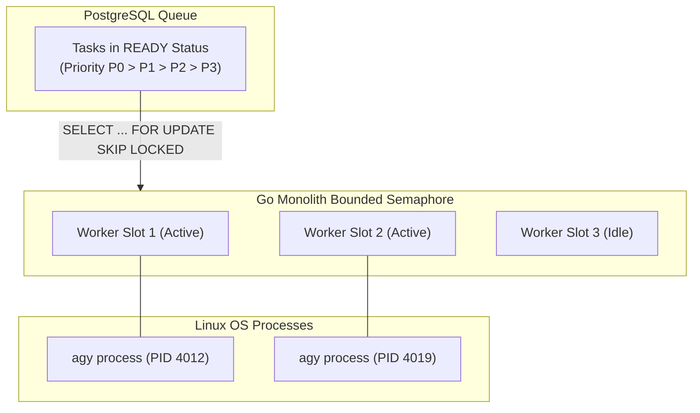

# Griffin Antigravity Execution Model & Concurrency Architecture

## 1. Execution Adapter Architecture

The Antigravity execution adapter is implemented in Go within `internal/providers/agy/`. It translates high-level Griffin task specifications into structured CLI executions, demuxes real-time streaming events, enforces schemas, captures execution artifacts, and records token usage.

```mermaid
flowchart TD
    TaskEngine[Griffin Task Engine] -->|Dispatch Task| AGYDriver[AntigravityDriver (Go)]
    
    subgraph AGYDriver ["internal/providers/agy/"]
        QueueGuard[Concurrency Limiter (Pool Size: 2)]
        ContextBuilder[Prompt & Schema Builder]
        SubprocessManager[Process Lifecycle & IO Streamer]
        StreamDemuxer[NDJSON Stream Parser]
        UsageTracker[Token & Metric Collector]
        
        QueueGuard --> ContextBuilder
        ContextBuilder --> SubprocessManager
        SubprocessManager <-->|stdin / stdout| CLIProcess["agy CLI subprocess"]
        CLIProcess --> StreamDemuxer
        StreamDemuxer --> UsageTracker
    end

    StreamDemuxer -->|SSE Stream Events| Frontend[Next.js PWA Client]
    UsageTracker -->|Result & Tokens| TaskEngine
```

---

## 2. Process Invocation Modes

Griffin supports two complementary execution modes depending on task nature:

### Mode 1: Single-Turn Task Execution (`-p` / `--output-format json`)
Best suited for discrete, self-contained worker tasks (e.g. summarizing a paper, extracting structured resume data, classifying opportunities):
```bash
agy -p "<sanitized_prompt>" \
    --model <model_slug> \
    --effort <effort_level> \
    --output-format json \
    --json-schema '<json_schema>' \
    --print-timeout <timeout_duration> \
    --add-dir /var/griffin/workspaces/<task_id>
```
- **Guarantees**: Fast, clean exit code, atomic JSON envelope returned on completion, zero shared state between tasks.

### Mode 2: Persistent Streaming Turn (`--input-format stream-json --output-format stream-json`)
Best suited for conversational JJ orchestration, multi-step code refactoring, or tasks requiring live user progress streaming:
```bash
agy --input-format stream-json \
    --output-format stream-json \
    --model <model_slug> \
    --effort <effort_level> \
    --add-dir /var/griffin/workspaces/<task_id>
```
- Standard input receives:
  ```json
  {"event": "user", "message": {"content": "<prompt_content>"}}
  ```
- Standard output emits NDJSON stream (`init`, `step_update`, `result`).
- Upon receiving `result`, standard input is either closed (graceful exit) or fed the next turn in the conversation DAG.

---

## 3. Real-Time Stream Demuxing

The Go adapter continuously reads `stdout` line-by-line and routes events through a strongly-typed Go channel:

```go
type StreamEvent struct {
    EventType      string                 `json:"event"`           // "init" | "step_update" | "result"
    ConversationID string                 `json:"conversation_id"`
    StepIndex      int                    `json:"step_index,omitempty"`
    StepType       string                 `json:"step_type,omitempty"` // "agent_response" | "tool" | "user_input"
    TextDelta      string                 `json:"text_delta,omitempty"`
    ToolName       string                 `json:"tool_name,omitempty"`
    ToolInfo       map[string]interface{} `json:"tool_info,omitempty"`
    Result         *ExecutionResult       `json:"result,omitempty"`
    Error          string                 `json:"error,omitempty"`
}
```

- When `event == "step_update"` and `text_delta != ""`, the delta is forwarded directly to the user's active SSE connection for live token typing.
- When `event == "step_update"` and `step_type == "tool"`, tool invocation status (e.g. `run_command`, `write_file`) is displayed in the task activity visualizer.
- When `event == "result"`, the adapter extracts final response text, schema-validated payload, and token metrics.

---

## 4. Conversation State & Context Isolation

To prevent concurrent tasks from corrupting conversation history:

1. **Independent Task Isolation**: Every discrete task in the PostgreSQL `tasks` table is assigned a distinct `conversation_id` (UUIDv4). Parallel workers **never** share an active `conversation_id`.
2. **Multi-Turn Conversation Resumption**: When a specific task requires multi-turn refinement (e.g. JJ clarifying an ambiguous request or an iterative code fix), the Go adapter passes `--conversation <task.RootID>`:
   ```bash
   agy -p "<next_prompt>" --conversation <root_id> --output-format json
   ```
   Antigravity CLI automatically loads the historical turns from disk, appends the new turn, and maintains perfect context continuity.

---

## 5. Concurrency Management & Queue Backpressure

Running unrestricted parallel LLM processes risks depleting account rate limits, exhausting memory on `t4g.medium` instances, and causing CPU starvation. Griffin enforces strict queue-based backpressure:



### Concurrency Rules
- **Worker Concurrency Limit**: Maximum **2 concurrent `agy` subprocesses** on `t4g.medium` (configurable via `GRIFFIN_MAX_CONCURRENT_AGY=2`).
- **PostgreSQL Backpressure**: If all worker slots are saturated, additional tasks remain safely in `READY` status in PostgreSQL. No memory is consumed by idle tasks.
- **Priority Scheduling**: High-priority tasks (`CRITICAL_P0`, `HIGH_P1`) jump ahead of background scans in the `ORDER BY priority DESC` query.

---

## 6. Failure Classification & Recovery Matrix

| CLI Exit Code / Output Condition | Classification | Engine Response |
| :--- | :--- | :--- |
| `status == "SUCCESS"` (Exit 0) | Clean Completion | Validate output against JSON schema; transition task to `COMPLETED`. |
| `error: "authentication required"` (Exit 1) | Auth Revoked | Transition runner status to `NEEDS_REAUTH`; alert user; pause queue. **Do not retry.** |
| Exit code 137 (SIGKILL) / Context Timeout | Execution Timeout | Increment `retry_count`. If `retry_count < max_retries`, backoff and retry; else mark `TIMED_OUT`. |
| `error: "invalid model selection"` (Exit 1) | Configuration Bug | Fail task immediately (`status = FAILED`); do not retry with bad model slug. |
| Non-zero exit with transient OS error | Transient Failure | Apply exponential backoff with jitter; re-queue task. |

---

## 7. Token Usage & Subscription Telemetry

Every completed `agy` execution emits a `usage` payload:
- `input_tokens`
- `output_tokens`
- `thinking_tokens`
- `cache_read_tokens`
- `total_tokens`

The Go adapter captures these values and inserts a record into the `agent_runs` table:
```sql
INSERT INTO agent_runs (
    task_id, agent_id, provider_name, model_name,
    prompt_tokens, completion_tokens, estimated_cost_usd,
    duration_ms, status
) VALUES (
    $1, $2, 'antigravity-cli', $3,
    $4, $5, 0.000000, -- Zero marginal cost under subscription
    $6, $7
);
```
This grants total visibility into personal subscription utilization without incurring pay-per-token charges.
