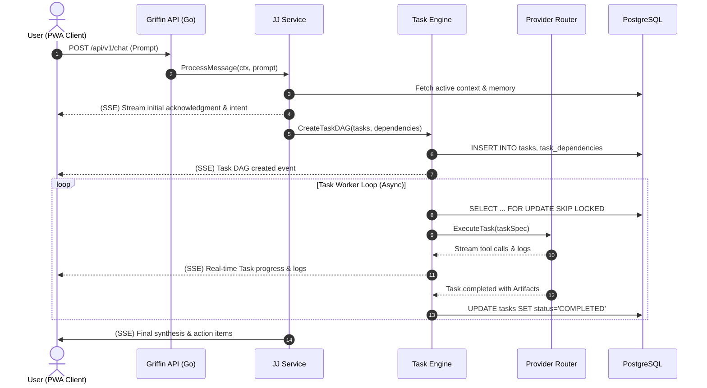

# Griffin Detailed Technical Architecture

## 1. Architectural Philosophy & Style

Griffin adopts a **Clean Modular Monolith** in Go 1.23. 

### Why a Modular Monolith over Microservices?
- **Zero Network Latency Between Subsystems**: JJ, the 11 domain managers, the task engine, and the scheduler execute in the same process memory space, eliminating serialization overhead and distributed tracing complexity.
- **Single Deployment Artifact**: A single static binary packaged into an unprivileged Docker scratch/alpine container simplifies hosting on Railway or Render.
- **Atomic Migrations**: Database schemas evolve via a single migration chain with strict consistency.
- **Operational Simplicity**: Ideal for a single-user system requiring 99.9% availability without Kubernetes or service mesh overhead.

---

## 2. Backend Architecture (Go 1.23)

The backend follows Clean Architecture principles with strict unidirectional dependencies:

```
griffin/
├── cmd/
│   └── server/                 # Application entrypoint
│       └── main.go
├── internal/
│   ├── api/                    # Delivery / Transport Layer
│   │   ├── middleware/         # Auth, RLS context, logging, recovery, rate-limiting
│   │   ├── handlers/           # HTTP REST & SSE handlers (JJ, Tasks, Approvals, etc.)
│   │   └── router.go           # Route definitions using standard net/http / chi
│   ├── domain/                 # Core Domain Entities & Interfaces (Zero dependencies)
│   │   ├── agent.go
│   │   ├── task.go
│   │   ├── approval.go
│   │   ├── schedule.go
│   │   ├── provider.go
│   │   └── opportunity.go
│   ├── service/                # Business Logic / Orchestration Layer
│   │   ├── jj/                 # JJ Orchestrator (Intent, Decomposition, Synthesis)
│   │   ├── managers/           # 11 Domain Manager Services (Career, Research, etc.)
│   │   ├── agentfactory/       # Dynamic Worker Specification Factory
│   │   ├── approval/           # Approval Gatekeeper & Audit Logging
│   │   └── briefing/           # Daily & Proactive Briefing Generator
│   ├── engine/                 # Core Execution Engine
│   │   ├── queue.go            # PostgreSQL 'FOR UPDATE SKIP LOCKED' Worker Pool
│   │   ├── lease.go            # Heartbeat, Lease Manager & Dead-Worker Reaper
│   │   ├── dag.go              # Task Dependency Graph Evaluator
│   │   └── dispatcher.go       # Worker execution dispatcher
│   ├── providers/              # Provider-Neutral AI Drivers
│   │   ├── provider.go         # Driver Interface definition
│   │   ├── router.go           # Capability-based Provider Routing & Fallback
│   │   ├── direct/             # Gemini API & Anthropic Messages API drivers
│   │   ├── agy/                # Antigravity CLI subprocess driver
│   │   ├── cowork/             # Claude Cowork Google Drive Inbox/Outbox driver
│   │   └── claudecode/         # Claude Code CLI subprocess driver
│   ├── scheduler/              # In-process Cron Engine
│   │   ├── cron.go             # robfig/cron/v3 wrapper (Asia/Kolkata)
│   │   └── recovery.go         # Boot-time missed schedule catch-up
│   ├── repo/                   # Data Access Layer (PostgreSQL)
│   │   ├── postgres/           # SQL queries using pgx / sqlc
│   │   │   ├── tasks.sql.go
│   │   │   ├── agents.sql.go
│   │   │   ├── approvals.sql.go
│   │   │   └── ...
│   │   └── storage/            # S3 / Supabase Storage Client
│   └── integrations/           # Third-Party External APIs
│       ├── gdrive/             # Google Drive API Client & Sync
│       ├── github/             # GitHub REST/GraphQL Client
│       └── email/              # SMTP / Resend / Postmark client
```

### Layer Rules
1. **Domain Layer**: Imports no internal packages. Defines core structs, domain errors, and repository interfaces.
2. **Repository Layer**: Implements domain interfaces against PostgreSQL using `pgxpool` and prepared statements.
3. **Service Layer**: Coordinates business use cases, orchestrating between domain entities, repositories, and providers.
4. **API Layer**: Handles JSON encoding/decoding, parameter validation, HTTP status codes, and Server-Sent Event streaming.

---

## 3. Real-Time Streaming & Communication Protocol

Griffin provides real-time updates for agent thoughts, tool execution, and task state changes.

### Decision: Server-Sent Events (SSE) over WebSockets
- **Rationale**: Griffin's client-to-server communication is primarily standard REST commands (e.g. `POST /api/v1/tasks`, `POST /api/v1/approvals/:id/approve`). Real-time requirements are predominantly **server-to-client streaming** (token streaming, live task logs, execution status).
- **Benefits**: SSE works over HTTP/2 with zero protocol upgrading issues, auto-reconnects with built-in `Last-Event-ID`, traverses enterprise firewalls seamlessly, and is lighter on server memory than bidirectional WebSockets.
- **Protocol**:
  - `GET /api/v1/conversations/:id/stream` — Streams JJ's live tokens and intermediate reasoning steps.
  - `GET /api/v1/tasks/:id/stream` — Streams real-time task logs, tool calls, and state transitions.
  - `GET /api/v1/notifications/stream` — Global user-level event stream for approvals, task completions, and daily briefings.



---

## 4. Frontend Architecture (Next.js 15 PWA)

The frontend is a unified, responsive Progressive Web App built with **Next.js 15 (App Router)**, **TypeScript**, **Tailwind CSS**, and **shadcn/ui**.

### PWA & Mobile-First Strategy
- **Installability**: Web App Manifest (`manifest.json`) and service worker registered using Workbox/Serwist. Installed as a standalone app on iOS (Safari Add to Home Screen) and Android (Chrome PWA).
- **Responsive Layout**: Dual-mode navigation:
  - *Desktop*: Collapsible left-hand navigation sidebar, persistent JJ chat pane, and high-density task/approval grids.
  - *Mobile*: Bottom navigation bar (Chat, Tasks, Approvals, Opportunities, More), full-screen card layouts, gesture-based pull-to-refresh.
- **Offline Shell**: The service worker caches static assets and shell UI. If offline, the client renders cached state and queues user prompts for automatic synchronization when connectivity resumes.

### State Management & Data Fetching
- **Server State**: Managed via **TanStack Query (React Query v5)** for optimistic UI updates, cache invalidation, and automatic background re-fetching.
- **Client State**: **Zustand** for transient UI state (active chat panel, modal state, audio recording state).
- **SSE Consumer Hook**: Custom `useSSE` hook wrapping standard `EventSource` with exponential reconnect and token buffer merging.

---

## 5. Caching and Storage Tiering

Griffin uses a tiered data strategy to ensure optimal performance, low latency, and clean separation between structured metadata and heavy artifacts:

```
[ Tier 1: In-Memory / Hot State ]
- In-process Go caches for active agent lease heartbeats and provider health state.
- React Query client cache for instant UI rendering.

[ Tier 2: Relational & Vector Store (Supabase PostgreSQL) ]
- Tasks, dependencies, leases, audit logs, user profiles, opportunities.
- pgvector embeddings (HNSW index) for semantic search over research memos, resumes, and knowledge chunks.

[ Tier 3: Human Document Workspace (Google Drive) ]
- Structured folders per manager.
- Final research memos, job application trackers, proposal drafts, slide decks.
- Synced locally or cloud-accessible.

[ Tier 4: Object Storage (Supabase Storage / S3) ]
- Raw task stdout/stderr execution logs.
- Scraped web HTML snapshots and raw dataset downloads.
- Intermediate code diffs and temporary pipeline artifacts.
```

---

## 6. Error Handling & Resilience Strategy

1. **Graceful Degradation**:
   - If a primary AI provider (e.g. Gemini Pro) experiences a 429 Rate Limit or 5xx outage, the `ProviderRouter` automatically cascades to Anthropic Claude 3.5 Sonnet or OpenAI fallback.
   - If the Google Drive API is temporarily unavailable, task outputs are written directly to Object Storage and queued for later Drive sync.
2. **Panic Recovery**:
   - HTTP handlers and background task workers wrap execution in structured `defer recover()` middleware, logging stack traces and marking the failed task with `status = FAILED` and `retry_count++`.
3. **Structured Domain Errors**:
   - Defined typed domain errors (`ErrTaskNotFound`, `ErrLeaseExpired`, `ErrApprovalRequired`, `ErrProviderExhausted`) mapped deterministically to HTTP status codes with RFC 7807 Problem Details.
