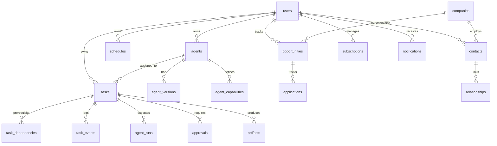

# Griffin Database Schema Specification

## 1. Schema Design Principles

The Griffin database runs on **Supabase PostgreSQL 16** with the following structural guarantees:
1. **Multi-Tenant Ready with Single-User Simplicity**: Every core table includes a `user_id UUID REFERENCES auth.users(id)` column with strict Row Level Security (RLS) policies enabled.
2. **Normalized & Relational**: Strong foreign key constraints, explicit delete cascades or restrict rules, and clean enums.
3. **High-Performance Queueing**: Targeted indexes on `(status, scheduled_for, priority DESC, created_at ASC)` to ensure `SELECT ... FOR UPDATE SKIP LOCKED` executes in sub-millisecond time.
4. **Audit Immutability**: `task_events` and `approvals` maintain append-only historical ledgers.

---

## 2. Entity Relationship Diagram (Core Modules)



---

## 3. PostgreSQL DDL Schema

```sql
-- Enable necessary extensions
CREATE EXTENSION IF NOT EXISTS "uuid-ossp";
CREATE EXTENSION IF NOT EXISTS "pgcrypto";
CREATE EXTENSION IF NOT EXISTS "vector";

-- -----------------------------------------------------------------------------
-- ENUMS
-- -----------------------------------------------------------------------------
CREATE TYPE task_status AS ENUM (
    'PENDING',
    'BLOCKED',
    'READY',
    'LEASED',
    'RUNNING',
    'AWAITING_APPROVAL',
    'COMPLETED',
    'FAILED',
    'CANCELLED',
    'TIMED_OUT'
);

CREATE TYPE task_priority AS ENUM (
    'CRITICAL_P0',
    'HIGH_P1',
    'NORMAL_P2',
    'BACKGROUND_P3'
);

CREATE TYPE approval_status AS ENUM (
    'PENDING',
    'APPROVED',
    'REJECTED',
    'EXPIRED'
);

CREATE TYPE approval_risk_level AS ENUM (
    'LOW',
    'MEDIUM',
    'HIGH',
    'CRITICAL'
);

CREATE TYPE opportunity_type AS ENUM (
    'JOB_FULLTIME',
    'JOB_INTERNSHIP',
    'HACKATHON',
    'FREELANCE_CONTRACT',
    'RESEARCH_GRANT',
    'FELLOWSHIP'
);

CREATE TYPE application_status AS ENUM (
    'IDENTIFIED',
    'PREPARING',
    'APPLIED',
    'INTERVIEWING',
    'OFFER',
    'REJECTED',
    'WITHDRAWN'
);

-- -----------------------------------------------------------------------------
-- 1. AGENTS & WORKERS
-- -----------------------------------------------------------------------------
CREATE TABLE agents (
    id UUID PRIMARY KEY DEFAULT gen_random_uuid(),
    user_id UUID NOT NULL REFERENCES auth.users(id) ON DELETE CASCADE,
    name VARCHAR(100) NOT NULL,
    role_type VARCHAR(50) NOT NULL, -- 'ORCHESTRATOR', 'MANAGER', 'WORKER'
    manager_domain VARCHAR(50),      -- 'CAREER', 'RESEARCH', 'ENGINEERING', etc.
    description TEXT NOT NULL,
    system_prompt TEXT NOT NULL,
    provider_preference VARCHAR(50) NOT NULL DEFAULT 'DIRECT_API',
    model_preference VARCHAR(50) NOT NULL DEFAULT 'gemini-3.8-flash-high',
    max_execution_timeout_sec INT NOT NULL DEFAULT 300,
    is_active BOOLEAN NOT NULL DEFAULT TRUE,
    created_at TIMESTAMPTZ NOT NULL DEFAULT NOW(),
    updated_at TIMESTAMPTZ NOT NULL DEFAULT NOW()
);

CREATE TABLE agent_versions (
    id UUID PRIMARY KEY DEFAULT gen_random_uuid(),
    agent_id UUID NOT NULL REFERENCES agents(id) ON DELETE CASCADE,
    version_number INT NOT NULL,
    system_prompt TEXT NOT NULL,
    change_summary TEXT,
    created_at TIMESTAMPTZ NOT NULL DEFAULT NOW(),
    UNIQUE(agent_id, version_number)
);

CREATE TABLE agent_capabilities (
    id UUID PRIMARY KEY DEFAULT gen_random_uuid(),
    agent_id UUID NOT NULL REFERENCES agents(id) ON DELETE CASCADE,
    capability_name VARCHAR(100) NOT NULL, -- 'web_search', 'read_files', 'gdrive_write', 'github_pr'
    granted_at TIMESTAMPTZ NOT NULL DEFAULT NOW(),
    UNIQUE(agent_id, capability_name)
);

-- -----------------------------------------------------------------------------
-- 2. TASKS & EXECUTION ENGINE
-- -----------------------------------------------------------------------------
CREATE TABLE tasks (
    id UUID PRIMARY KEY DEFAULT gen_random_uuid(),
    user_id UUID NOT NULL REFERENCES auth.users(id) ON DELETE CASCADE,
    parent_id UUID REFERENCES tasks(id) ON DELETE SET NULL,
    root_id UUID REFERENCES tasks(id) ON DELETE SET NULL,
    assigned_agent_id UUID REFERENCES agents(id) ON DELETE SET NULL,
    manager_domain VARCHAR(50) NOT NULL,
    title VARCHAR(255) NOT NULL,
    goal TEXT NOT NULL,
    input_payload JSONB NOT NULL DEFAULT '{}'::jsonb,
    output_payload JSONB,
    status task_status NOT NULL DEFAULT 'PENDING',
    priority task_priority NOT NULL DEFAULT 'NORMAL_P2',
    idempotency_key VARCHAR(255),
    
    -- Distributed Leases
    leased_by VARCHAR(100),
    lease_expires_at TIMESTAMPTZ,
    
    -- Execution tracking & retries
    retry_count INT NOT NULL DEFAULT 0,
    max_retries INT NOT NULL DEFAULT 3,
    failure_reason TEXT,
    scheduled_for TIMESTAMPTZ,
    started_at TIMESTAMPTZ,
    completed_at TIMESTAMPTZ,
    
    created_at TIMESTAMPTZ NOT NULL DEFAULT NOW(),
    updated_at TIMESTAMPTZ NOT NULL DEFAULT NOW()
);

-- Fast lookup for distributed queue polling
CREATE INDEX idx_tasks_queue_poll 
ON tasks (status, scheduled_for, priority DESC, created_at ASC)
WHERE status = 'READY';

CREATE INDEX idx_tasks_lease_reap 
ON tasks (status, lease_expires_at)
WHERE status IN ('LEASED', 'RUNNING');

CREATE UNIQUE INDEX idx_tasks_idempotency 
ON tasks (user_id, idempotency_key)
WHERE idempotency_key IS NOT NULL AND status NOT IN ('CANCELLED', 'FAILED');

CREATE TABLE task_dependencies (
    task_id UUID NOT NULL REFERENCES tasks(id) ON DELETE CASCADE,
    depends_on_task_id UUID NOT NULL REFERENCES tasks(id) ON DELETE CASCADE,
    created_at TIMESTAMPTZ NOT NULL DEFAULT NOW(),
    PRIMARY KEY (task_id, depends_on_task_id)
);

CREATE TABLE agent_runs (
    id UUID PRIMARY KEY DEFAULT gen_random_uuid(),
    task_id UUID NOT NULL REFERENCES tasks(id) ON DELETE CASCADE,
    agent_id UUID NOT NULL REFERENCES agents(id) ON DELETE CASCADE,
    provider_name VARCHAR(50) NOT NULL,
    model_name VARCHAR(100) NOT NULL,
    prompt_tokens INT NOT NULL DEFAULT 0,
    completion_tokens INT NOT NULL DEFAULT 0,
    estimated_cost_usd NUMERIC(10, 6) NOT NULL DEFAULT 0,
    duration_ms INT NOT NULL DEFAULT 0,
    status VARCHAR(50) NOT NULL,
    created_at TIMESTAMPTZ NOT NULL DEFAULT NOW()
);

CREATE TABLE task_events (
    id BIGSERIAL PRIMARY KEY,
    task_id UUID NOT NULL REFERENCES tasks(id) ON DELETE CASCADE,
    event_type VARCHAR(50) NOT NULL, -- 'STATUS_CHANGE', 'TOOL_CALLED', 'RETRY', 'LOG'
    message TEXT NOT NULL,
    metadata JSONB NOT NULL DEFAULT '{}'::jsonb,
    created_at TIMESTAMPTZ NOT NULL DEFAULT NOW()
);

CREATE INDEX idx_task_events_task_id ON task_events(task_id, created_at ASC);

-- -----------------------------------------------------------------------------
-- 3. APPROVALS & ARTIFACTS
-- -----------------------------------------------------------------------------
CREATE TABLE approvals (
    id UUID PRIMARY KEY DEFAULT gen_random_uuid(),
    user_id UUID NOT NULL REFERENCES auth.users(id) ON DELETE CASCADE,
    task_id UUID NOT NULL REFERENCES tasks(id) ON DELETE CASCADE,
    action_type VARCHAR(100) NOT NULL, -- 'SEND_EMAIL', 'APPLY_JOB', 'GITHUB_MERGE', 'FINANCIAL'
    risk_level approval_risk_level NOT NULL DEFAULT 'MEDIUM',
    summary TEXT NOT NULL,
    action_payload JSONB NOT NULL,
    status approval_status NOT NULL DEFAULT 'PENDING',
    decided_by UUID REFERENCES auth.users(id),
    decision_reason TEXT,
    expires_at TIMESTAMPTZ,
    created_at TIMESTAMPTZ NOT NULL DEFAULT NOW(),
    updated_at TIMESTAMPTZ NOT NULL DEFAULT NOW()
);

CREATE TABLE artifacts (
    id UUID PRIMARY KEY DEFAULT gen_random_uuid(),
    user_id UUID NOT NULL REFERENCES auth.users(id) ON DELETE CASCADE,
    task_id UUID REFERENCES tasks(id) ON DELETE SET NULL,
    title VARCHAR(255) NOT NULL,
    artifact_type VARCHAR(50) NOT NULL, -- 'GOOGLE_DOC', 'PDF', 'MARKDOWN', 'CODE_DIFF', 'JSON'
    storage_uri TEXT NOT NULL,
    gdrive_file_id VARCHAR(255),
    file_size_bytes BIGINT,
    mime_type VARCHAR(100),
    metadata JSONB NOT NULL DEFAULT '{}'::jsonb,
    created_at TIMESTAMPTZ NOT NULL DEFAULT NOW()
);

-- -----------------------------------------------------------------------------
-- 4. PERSISTENT CLOUD SCHEDULING
-- -----------------------------------------------------------------------------
CREATE TABLE schedules (
    id UUID PRIMARY KEY DEFAULT gen_random_uuid(),
    user_id UUID NOT NULL REFERENCES auth.users(id) ON DELETE CASCADE,
    manager_domain VARCHAR(50) NOT NULL,
    name VARCHAR(100) NOT NULL,
    cron_expression VARCHAR(50) NOT NULL, -- e.g. '0 8 * * *' (08:00 IST)
    timezone VARCHAR(50) NOT NULL DEFAULT 'Asia/Kolkata',
    task_spec_template JSONB NOT NULL,
    is_paused BOOLEAN NOT NULL DEFAULT FALSE,
    last_run_at TIMESTAMPTZ,
    next_run_at TIMESTAMPTZ NOT NULL,
    created_at TIMESTAMPTZ NOT NULL DEFAULT NOW(),
    updated_at TIMESTAMPTZ NOT NULL DEFAULT NOW()
);

-- -----------------------------------------------------------------------------
-- 5. DOMAIN ENTITIES (Career, Opportunities, Networking, Finance)
-- -----------------------------------------------------------------------------
CREATE TABLE companies (
    id UUID PRIMARY KEY DEFAULT gen_random_uuid(),
    user_id UUID NOT NULL REFERENCES auth.users(id) ON DELETE CASCADE,
    name VARCHAR(255) NOT NULL,
    domain VARCHAR(255),
    tier VARCHAR(50), -- 'TIER_1_DREAM', 'TIER_2_HIGH_FIT', 'TIER_3_SAFETY'
    careers_page_url TEXT,
    notes TEXT,
    created_at TIMESTAMPTZ NOT NULL DEFAULT NOW()
);

CREATE TABLE opportunities (
    id UUID PRIMARY KEY DEFAULT gen_random_uuid(),
    user_id UUID NOT NULL REFERENCES auth.users(id) ON DELETE CASCADE,
    company_id UUID REFERENCES companies(id) ON DELETE SET NULL,
    title VARCHAR(255) NOT NULL,
    type opportunity_type NOT NULL,
    url TEXT,
    deadline TIMESTAMPTZ,
    fit_score NUMERIC(3, 2), -- 0.00 to 1.00
    requirements_summary TEXT,
    status VARCHAR(50) NOT NULL DEFAULT 'IDENTIFIED',
    metadata JSONB NOT NULL DEFAULT '{}'::jsonb,
    created_at TIMESTAMPTZ NOT NULL DEFAULT NOW()
);

CREATE TABLE applications (
    id UUID PRIMARY KEY DEFAULT gen_random_uuid(),
    user_id UUID NOT NULL REFERENCES auth.users(id) ON DELETE CASCADE,
    opportunity_id UUID NOT NULL REFERENCES opportunities(id) ON DELETE CASCADE,
    resume_artifact_id UUID REFERENCES artifacts(id),
    cover_letter_artifact_id UUID REFERENCES artifacts(id),
    status application_status NOT NULL DEFAULT 'IDENTIFIED',
    applied_at TIMESTAMPTZ,
    follow_up_due TIMESTAMPTZ,
    notes TEXT,
    created_at TIMESTAMPTZ NOT NULL DEFAULT NOW(),
    updated_at TIMESTAMPTZ NOT NULL DEFAULT NOW()
);

CREATE TABLE contacts (
    id UUID PRIMARY KEY DEFAULT gen_random_uuid(),
    user_id UUID NOT NULL REFERENCES auth.users(id) ON DELETE CASCADE,
    company_id UUID REFERENCES companies(id) ON DELETE SET NULL,
    name VARCHAR(255) NOT NULL,
    headline VARCHAR(255),
    email VARCHAR(255),
    linkedin_url TEXT,
    relationship_strength INT DEFAULT 1, -- 1 (Weak) to 5 (Strong)
    last_interaction_at TIMESTAMPTZ,
    next_followup_at TIMESTAMPTZ,
    notes TEXT,
    created_at TIMESTAMPTZ NOT NULL DEFAULT NOW()
);

CREATE TABLE relationships (
    id UUID PRIMARY KEY DEFAULT gen_random_uuid(),
    contact_id UUID NOT NULL REFERENCES contacts(id) ON DELETE CASCADE,
    interaction_type VARCHAR(50) NOT NULL, -- 'EMAIL', 'COFFEE_CHAT', 'INTERVIEW', 'LINKEDIN'
    summary TEXT NOT NULL,
    action_items TEXT,
    occurred_at TIMESTAMPTZ NOT NULL,
    created_at TIMESTAMPTZ NOT NULL DEFAULT NOW()
);

CREATE TABLE research_projects (
    id UUID PRIMARY KEY DEFAULT gen_random_uuid(),
    user_id UUID NOT NULL REFERENCES auth.users(id) ON DELETE CASCADE,
    title VARCHAR(255) NOT NULL,
    problem_statement TEXT NOT NULL,
    status VARCHAR(50) NOT NULL DEFAULT 'IDEATION',
    gdrive_folder_id VARCHAR(255),
    literature_summary TEXT,
    bibtex_entries TEXT,
    created_at TIMESTAMPTZ NOT NULL DEFAULT NOW(),
    updated_at TIMESTAMPTZ NOT NULL DEFAULT NOW()
);

CREATE TABLE benefits (
    id UUID PRIMARY KEY DEFAULT gen_random_uuid(),
    user_id UUID NOT NULL REFERENCES auth.users(id) ON DELETE CASCADE,
    provider_name VARCHAR(100) NOT NULL, -- 'AWS Activate', 'GitHub Student', 'Google Cloud'
    category VARCHAR(50) NOT NULL,      -- 'CLOUD_CREDIT', 'API_CREDIT', 'SUBSCRIPTION_PERK'
    initial_amount_usd NUMERIC(10, 2),
    remaining_amount_usd NUMERIC(10, 2),
    expires_at TIMESTAMPTZ,
    status VARCHAR(50) NOT NULL DEFAULT 'ACTIVE',
    notes TEXT,
    created_at TIMESTAMPTZ NOT NULL DEFAULT NOW()
);

CREATE TABLE subscriptions (
    id UUID PRIMARY KEY DEFAULT gen_random_uuid(),
    user_id UUID NOT NULL REFERENCES auth.users(id) ON DELETE CASCADE,
    service_name VARCHAR(100) NOT NULL, -- 'Anthropic Claude Pro', 'ChatGPT Plus', 'Railway'
    cost_per_period NUMERIC(10, 2) NOT NULL,
    billing_period VARCHAR(20) NOT NULL DEFAULT 'MONTHLY',
    next_renewal_date DATE NOT NULL,
    auto_renew BOOLEAN NOT NULL DEFAULT TRUE,
    payment_method VARCHAR(100),
    created_at TIMESTAMPTZ NOT NULL DEFAULT NOW()
);

CREATE TABLE notifications (
    id UUID PRIMARY KEY DEFAULT gen_random_uuid(),
    user_id UUID NOT NULL REFERENCES auth.users(id) ON DELETE CASCADE,
    title VARCHAR(255) NOT NULL,
    body TEXT NOT NULL,
    channel VARCHAR(50) NOT NULL DEFAULT 'IN_APP', -- 'IN_APP', 'WEB_PUSH', 'EMAIL'
    priority VARCHAR(20) NOT NULL DEFAULT 'NORMAL',
    read_at TIMESTAMPTZ,
    action_url TEXT,
    created_at TIMESTAMPTZ NOT NULL DEFAULT NOW()
);

-- -----------------------------------------------------------------------------
-- 6. ROW LEVEL SECURITY (RLS) POLICIES
-- -----------------------------------------------------------------------------
ALTER TABLE agents ENABLE ROW LEVEL SECURITY;
ALTER TABLE tasks ENABLE ROW LEVEL SECURITY;
ALTER TABLE approvals ENABLE ROW LEVEL SECURITY;
ALTER TABLE artifacts ENABLE ROW LEVEL SECURITY;
ALTER TABLE schedules ENABLE ROW LEVEL SECURITY;
ALTER TABLE opportunities ENABLE ROW LEVEL SECURITY;
ALTER TABLE applications ENABLE ROW LEVEL SECURITY;
ALTER TABLE contacts ENABLE ROW LEVEL SECURITY;
ALTER TABLE research_projects ENABLE ROW LEVEL SECURITY;
ALTER TABLE benefits ENABLE ROW LEVEL SECURITY;
ALTER TABLE subscriptions ENABLE ROW LEVEL SECURITY;
ALTER TABLE notifications ENABLE ROW LEVEL SECURITY;

-- Standard tenant isolation policy pattern
CREATE POLICY user_isolation_policy_tasks ON tasks
    FOR ALL USING (auth.uid() = user_id);

CREATE POLICY user_isolation_policy_agents ON agents
    FOR ALL USING (auth.uid() = user_id);

CREATE POLICY user_isolation_policy_approvals ON approvals
    FOR ALL USING (auth.uid() = user_id);

CREATE POLICY user_isolation_policy_artifacts ON artifacts
    FOR ALL USING (auth.uid() = user_id);

CREATE POLICY user_isolation_policy_schedules ON schedules
    FOR ALL USING (auth.uid() = user_id);
```
