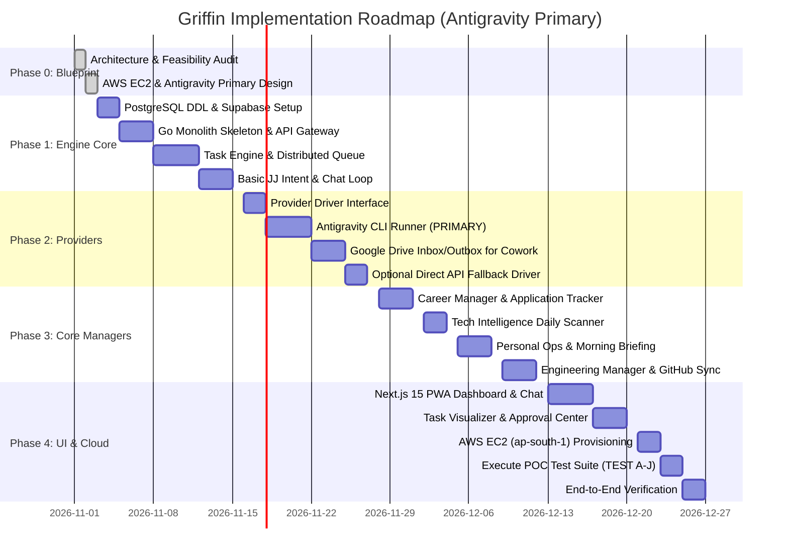

# Griffin Implementation Roadmap & Delivery Plan (Antigravity Primary)

## 1. Roadmap Overview & V1 Scope Boundaries

Griffin is delivered in progressive, testable phases. The platform prioritizes the **Google Antigravity CLI (`agy`)** as the primary execution engine from Day 1.

### V1 Core Scope
- Single-user architecture with Supabase Auth and RLS.
- Go Modular Monolith deployed on **AWS EC2 (`t4g.medium` $\rightarrow$ `t4g.small` Graviton2 ARM64 in `ap-south-1` Mumbai)**.
- **Antigravity CLI as the PRIMARY default execution provider** on EC2 under dedicated `griffin` user.
- Persistent PostgreSQL Task Engine with DAG dependencies, 60s leases, and `SKIP LOCKED` queues.
- Bounded Antigravity concurrency pool (max 2 parallel workers) with queue backpressure.
- Durable Scheduler running in `Asia/Kolkata` timezone (08:00 IST morning briefings).
- Remote administration via **AWS SSM Session Manager** with zero open SSH ports.
- Claude Cowork asynchronous Google Drive Inbox/Outbox workflow for long-form synthesis.
- Direct model APIs as strictly optional, non-silent fallbacks (`allow_paid_fallback = false`).
- Core 4 Managers: **Career**, **Tech Intelligence**, **Engineering**, and **Personal Operations**.
- Unified Next.js 15 PWA on Vercel with JJ chat, Task DAG view, and Approval Center.

---

## 2. Phased Milestone Plan

---

## 3. Phase Breakdown & Acceptance Criteria

### Phase 0: Architecture & Provider Specification (Completed)
- **Deliverables**: Complete architecture suite under `docs/architecture/` with Antigravity as primary engine, POC test plan, auth strategy, and routing policies.

### Phase 1: Core Engine & Data Foundations
- **Goal**: Establish the Go backend, PostgreSQL migrations, and persistent task engine.
- **Milestones**:
  1. Initialize Go module `github.com/griffin/core`.
  2. Apply PostgreSQL migrations to Supabase (tasks, dependencies, leases, approvals, RLS).
  3. Implement `engine.Queue` with PostgreSQL `FOR UPDATE SKIP LOCKED`.
  4. Implement DAG dependency evaluator and lease renewal heartbeats.
  5. Build basic JJ conversational loop with SSE streaming.

### Phase 2: Antigravity Primary Runner & Workspace Protocols
- **Goal**: Implement the primary Antigravity adapter and file handoffs.
- **Milestones**:
  1. Implement `AntigravityDriver` supporting `-p`, `stream-json`, `--json-schema`, and `--conversation`.
  2. Implement stream demuxer for real-time `step_update` and token streaming.
  3. Implement Google Drive API client and Claude Cowork `Inbox/Outbox` poller.
  4. Implement optional direct API fallback driver behind `allow_paid_fallback` flag.
  5. Build canary health probe verifying CLI authentication status.
- **Acceptance Criteria**: Discrete tasks execute via `agy` headlessly returning verified JSON. Streaming turns emit live deltas. Token counts are recorded with zero API costs.

### Phase 3: Core Specialist Managers & Durable Scheduling
- **Goal**: Operationalize the first 4 essential domain managers.
- **Milestones**:
  1. **Career Manager**: Opportunity ingestion and resume tailoring via `agy`.
  2. **Tech Intelligence Manager**: Scheduled arXiv and GitHub trending sweeps.
  3. **Personal Operations Manager**: Google Calendar integration and 08:00 IST morning briefing.
  4. **Engineering Manager**: GitHub API integration and code review worker.
  5. In-process `robfig/cron/v3` scheduler in `Asia/Kolkata` timezone.

### Phase 4: Unified PWA Frontend & Approval Center
- **Goal**: Deliver a responsive desktop/mobile PWA interface.
- **Milestones**:
  1. Next.js 15 App Router with Tailwind CSS and shadcn/ui.
  2. JJ Chat canvas with live token streaming and tool call visualizers.
  3. Task DAG visualizer and Approval Center.
  4. Service worker, manifest, and Web Push notifications.

### Phase 5: Cloud Deployment & POC Suite Verification
- **Goal**: Deploy to AWS EC2 in `ap-south-1` and verify the Antigravity POC test suite.
- **Milestones**:
  1. Provision EC2 `t4g.medium` instance in `ap-south-1` with KMS-encrypted 30 GB gp3 volume.
  2. Perform initial interactive authentication via SSM Remote OAuth Loop (**TEST A**).
  3. Execute automated POC test suite (**TEST B through TEST J**).
  4. Start `griffin.service` under `systemd`.
  5. Deploy Next.js PWA to Vercel pointing to EC2 backend.
- **Acceptance Criteria**: All 10 POC tests pass. Griffin operates 24/7 in the cloud on EC2, executing scheduled briefings and tasks via Antigravity subscription without manual intervention.
