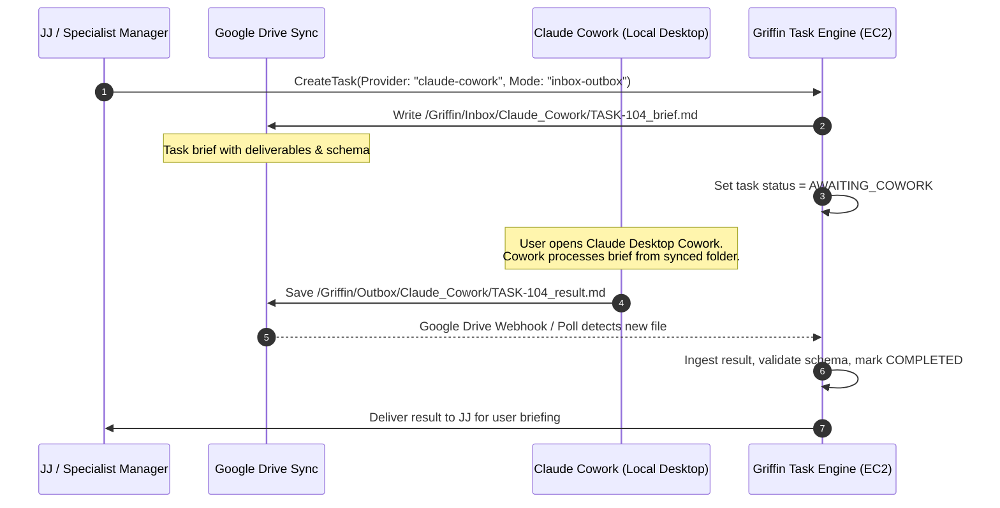

# Griffin AI Provider Architecture & Feasibility Audit (Antigravity Primary)

## 1. Provider Feasibility & Priority Matrix

Griffin designates the **Google Antigravity CLI (`agy`)** as its **PRIMARY** reasoning and execution engine, powered by the user's active Antigravity subscription:

| Provider / Environment | Platform Priority | Feasibility Classification | Role & Execution Model in Griffin |
| :--- | :---: | :--- | :--- |
| **Google Antigravity CLI (`agy`)** | **PRIMARY DEFAULT (1)** | **FEASIBLE WITH SUPPORTED REMOTE OAUTH ON EC2** | **Default Engine for Entire Platform**: Hosts JJ and all specialist workers on AWS EC2. Authenticated via the official Remote SSH OAuth flow (`agy`). Communicates with Go backend via local stream-json / JSON pipes under dedicated `griffin` user. **Zero per-token API charges; 100% subscription-backed.** |
| **Anthropic Claude Cowork** | **SPECIALIST (2)** | **FEASIBLE VIA ASYNC DRIVE INBOX/OUTBOX** | **Deep Synthesis Specialist**: Utilized for long-form research memos, client proposals, and PRDs via the Google Drive Inbox/Outbox handoff protocol when the user is operating Claude Desktop. |
| **Claude Code CLI** | **ENGINEERING SPECIALIST** | **FEASIBLE WITH LIMITATIONS** | **Codebase Engineering Worker**: Targeted runs for repository audits, automated PR reviews, and complex feature development. |
| **Direct Model APIs** (Gemini, Claude, OpenAI) | **EXPLICIT FALLBACK ONLY (3)** | **FEASIBLE NOW (PAID USAGE)** | **Explicit User-Approved Fallback**: Disabled by default (`allow_paid_fallback = false`). Invoked ONLY if Antigravity is pending re-authentication AND the user explicitly opts into paid API execution. **Zero API keys are required for Griffin V1.** |

---

## 2. Antigravity Cloud Execution Architecture on EC2

Rather than delegating Antigravity to local desktop runs, Griffin runs `agy` 24/7 on the **AWS EC2 Ubuntu VM (`ap-south-1`)**:

1. **Remote Interactive Authentication**:
   - Authenticated once using the official Antigravity **Remote SSH OAuth Flow** via AWS SSM Session Manager.
   - Credentials persist on the encrypted EBS gp3 volume (`/home/griffin/.gemini/antigravity-cli/`) and are backed by DBus Secret Service keyring.
2. **Headless Execution Contracts**:
   - Single-shot tasks execute via `agy -p "<prompt>" --output-format json --json-schema '<schema>'`.
   - Streaming/conversational tasks execute via `agy --input-format stream-json --output-format stream-json`.
3. **Session Reconnection**:
   - Multi-step tasks preserve full context using `--conversation <UUID>`, reloading transcript history from disk.
4. **Health Monitoring & Canary**:
   - Scheduled canary probe runs every 6 hours (`agy -p "ping"`).
   - If token expiration occurs, the runner enters `NEEDS_REAUTH`, pausing the queue with high-priority user alerts instead of silently burning paid API tokens.

---

## 3. Provider-Neutral Execution Abstraction

All provider executions adhere to the Go `ProviderDriver` interface:

```go
package domain

import (
	"context"
	"time"
)

type ExecutionTaskSpec struct {
	TaskID            string                 `json:"task_id"`
	ManagerID         string                 `json:"manager_id"`
	AgentID           string                 `json:"agent_id"`
	SystemPrompt      string                 `json:"system_prompt"`
	UserPrompt        string                 `json:"user_prompt"`
	Tools             []ToolDefinition       `json:"tools"`
	JSONSchema        string                 `json:"json_schema,omitempty"`
	ReasoningEffort   string                 `json:"reasoning_effort"` // "low" | "medium" | "high"
	Timeout           time.Duration          `json:"timeout"`
	AllowPaidFallback bool                   `json:"allow_paid_fallback"`
}

type ExecutionResult struct {
	TaskID         string                 `json:"task_id"`
	ConversationID string                 `json:"conversation_id"`
	ProviderName   string                 `json:"provider_name"`
	Model          string                 `json:"model"`
	OutputText     string                 `json:"output_text"`
	StructuredJSON map[string]interface{} `json:"structured_json,omitempty"`
	Artifacts      []ArtifactReference    `json:"artifacts"`
	TokensUsed     TokenUsage             `json:"tokens_used"`
	CostUSD        float64                `json:"cost_usd"`
	Duration       time.Duration          `json:"duration"`
}

type ProviderDriver interface {
	Name() string
	Capabilities() []string
	ExecuteTask(ctx context.Context, spec ExecutionTaskSpec) (*ExecutionResult, error)
	StreamTask(ctx context.Context, spec ExecutionTaskSpec) (<-chan StreamEvent, error)
	HealthCheck(ctx context.Context) (bool, error)
}
```

---

## 4. The Claude Cowork Asynchronous Protocol

Claude Cowork operates as an asynchronous specialist worker through Google Drive:



---

## 5. Strict Fallback & Cost Guardrails

1. **No Silent Billing**: Griffin strictly disables automated paid fallbacks. If Antigravity requires re-auth, tasks enter `BLOCKED_AWAITING_PROVIDER`.
2. **Explicit Opt-In**: Only tasks with `allow_paid_fallback = true` can access external APIs.
3. **Zero Mandatory API Keys**: Griffin V1 operates completely on the authenticated `agy` CLI without requiring users to purchase API Studio credits.
