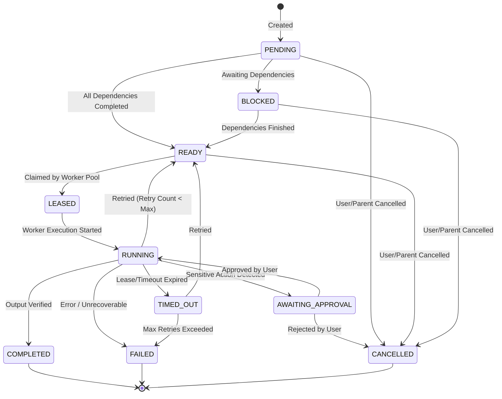

# Griffin Task Engine Architecture

## 1. Engine Overview

The Griffin Task Engine is a fault-tolerant, persistent Directed Acyclic Graph (DAG) orchestrator and distributed task queue. It is built natively on top of **Go 1.23** and **PostgreSQL 16**, leveraging PostgreSQL's `FOR UPDATE SKIP LOCKED` primitive to achieve robust distributed queue semantics without introducing external message brokers (such as Redis, RabbitMQ, or Celery).

### Key Architectural Tenets
1. **Durable Persistence**: All task state transitions, inputs, outputs, and execution logs persist in PostgreSQL.
2. **Crash Resilience**: If the backend process crashes or a cloud instance restarts, active execution leases expire automatically, and orphan tasks are reclaimed without data loss.
3. **Strict DAG Ordering**: Dependent tasks cannot execute until all prerequisite parent tasks have successfully completed.
4. **Idempotency**: Every task execution carries an idempotency key to prevent accidental re-runs of side-effecting operations.
5. **Human Approval Gates**: Sensitive actions transition tasks to a blocking approval state that halts execution until an authorized human decision is recorded.

---

## 2. Task Lifecycle State Machine



### State Definitions & Valid Transitions

| State | Description | Allowed Next States |
| :--- | :--- | :--- |
| `PENDING` | Task created, awaiting dependency evaluation. | `READY`, `BLOCKED`, `CANCELLED` |
| `BLOCKED` | Waiting for one or more parent tasks in the DAG to finish. | `READY`, `CANCELLED` |
| `READY` | All dependencies met; eligible to be leased by worker pool. | `LEASED`, `CANCELLED` |
| `LEASED` | Claimed by an execution worker; heartbeat initiated. | `RUNNING`, `READY` (lease lost), `TIMED_OUT` |
| `RUNNING` | Active AI provider or tool execution in progress. | `COMPLETED`, `AWAITING_APPROVAL`, `FAILED`, `READY` (retry) |
| `AWAITING_APPROVAL` | Execution paused; requires user review in Approval Center. | `RUNNING` (approved), `CANCELLED` (rejected) |
| `COMPLETED` | Execution finished and output validated against schema. | Terminal state |
| `FAILED` | Execution threw error and retry attempts were exhausted. | Terminal state |
| `CANCELLED` | Explicitly aborted by user or cascaded from parent failure. | Terminal state |
| `TIMED_OUT` | Execution exceeded maximum lease duration without heartbeat. | `READY` (if retries remain), `FAILED` |

---

## 3. Distributed Queue & Lease Model (`SKIP LOCKED`)

Griffin avoids Redis by utilizing PostgreSQL 16's row-level locking primitives. Multiple concurrent worker goroutines inside the Go monolith pull tasks safely without lock contention.

### 1. Task Acquisition Query
```sql
-- Atomically claim the highest-priority READY task
UPDATE tasks
SET 
    status = 'LEASED',
    leased_by = $1, -- worker_instance_id (e.g. 'griffin-cloud-worker-1')
    lease_expires_at = NOW() + INTERVAL '60 seconds',
    updated_at = NOW()
WHERE id = (
    SELECT id
    FROM tasks
    WHERE status = 'READY'
      AND (scheduled_for IS NULL OR scheduled_for <= NOW())
    ORDER BY priority DESC, created_at ASC
    LIMIT 1
    FOR UPDATE SKIP LOCKED
)
RETURNING id, parent_id, manager_id, agent_spec, input_payload, retry_count, max_retries;
```

### 2. Heartbeat & Renewal
- While a worker executes a task, a background goroutine renews the lease every 15 seconds:
  ```sql
  UPDATE tasks
  SET lease_expires_at = NOW() + INTERVAL '60 seconds'
  WHERE id = $1 AND leased_by = $2 AND status IN ('LEASED', 'RUNNING');
  ```
- If a task's total runtime exceeds `max_execution_duration` (e.g. 10 minutes), the engine terminates execution and transitions the task to `TIMED_OUT`.

### 3. Orphan Lease Reaper
A background cleanup goroutine runs every 30 seconds to reclaim tasks abandoned by crashed workers:
```sql
UPDATE tasks
SET 
    status = CASE 
        WHEN retry_count + 1 < max_retries THEN 'READY'::task_status 
        ELSE 'TIMED_OUT'::task_status 
    END,
    retry_count = retry_count + 1,
    leased_by = NULL,
    lease_expires_at = NULL,
    updated_at = NOW()
WHERE status IN ('LEASED', 'RUNNING')
  AND lease_expires_at < NOW();
```

---

## 4. DAG Dependency Management & Cascading

### Dependency Resolution
Tasks specify parents via the `task_dependencies` table (`task_id`, `depends_on_task_id`).
1. When a task reaches `COMPLETED`, the engine triggers `ResolveDownstreamTasks(completedTaskID)`.
2. The query finds all child tasks where `status = 'BLOCKED'`.
3. For each child, it verifies whether all prerequisite tasks in `task_dependencies` have reached `COMPLETED`.
4. If all parents are satisfied, the child task's status atomically transitions to `READY`.

### Cascading Failure & Cancellation
- If a parent task transitions to `FAILED` or `CANCELLED`:
  - By default, downstream dependent tasks transition to `CANCELLED` with a `failure_reason = 'Parent task failed'`.
  - Alternatively, tasks configured with `failure_policy = 'CONTINUE_ON_FAILURE'` receive the parent's error payload and execute recovery logic.

---

## 5. Idempotency & Retries

### Idempotency Keys
Every task specifies a deterministic `idempotency_key` (e.g. `hash(user_id + manager + action + date + params)`).
- Before inserting a new task, the engine checks for existing non-cancelled tasks with the same key.
- If an identical task is already running or completed, the engine returns the existing task record, preventing duplicate email sends, duplicate applications, or repeated API calls.

### Retry Backoff Strategy
When a transient failure occurs (network timeout, AI provider 429/503 rate limit):
1. The engine checks if `retry_count < max_retries` (default: 3).
2. Computes exponential backoff with jitter:
   $$\text{Backoff} = \min(\text{MaxBackoff}, \text{BaseBackoff} \times 2^{\text{retry\_count}}) + \text{jitter}$$
3. Sets `scheduled_for = NOW() + backoff` and transitions the task to `READY`.
4. Appends a failure event to `task_events` for full audit visibility.

---

## 6. Verification & Result Quality Gates

Before a task is marked `COMPLETED`:
1. **Schema Validation**: If the worker task defined a JSON output schema, the engine validates the output payload against the schema.
2. **Artifact Verification**: If the task generated a Google Doc, PDF, or file artifact, the engine verifies that the file exists and is readable.
3. **LLM Sanity Evaluation (Optional)**: For high-stakes synthesis tasks, JJ runs a fast verification check (e.g., Gemini Flash) to ensure all user constraints and questions were addressed.
