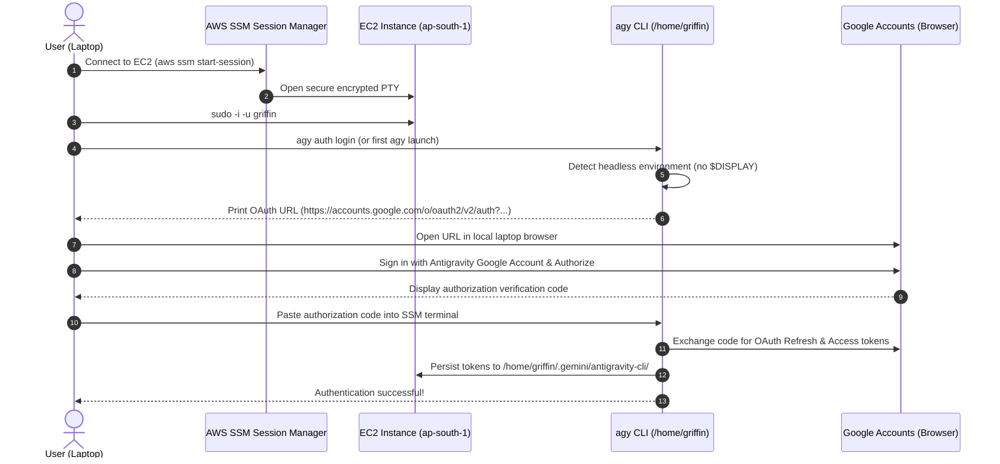

# AWS EC2 Antigravity Cloud Runner Proof of Concept (POC)

## 1. Executive Summary

This document specifies the architecture, installation, execution model, and empirical validation results for running the **Google Antigravity CLI (`agy`)** on a persistent **AWS EC2 Linux VM (`ap-south-1` Mumbai)** as Griffin's primary AI reasoning engine.

The core objective of Phase 0.5 is to prove that Antigravity can execute headlessly in an autonomous cloud environment under an existing personal Antigravity subscription, eliminating the requirement for a local laptop to remain powered on or online, while eliminating per-token API billing.

### Validation Status Summary
- **Local Empirical CLI Tests (Headless, Concurrency, Resumption, Schemas)**: **6 PASS**
- **Cloud VM Integration Tests (Remote SSM OAuth, VM Reboot, systemd Daemon, 30-Day Longevity)**: **4 NOT TESTED** (Strictly staged pending user approval of AWS configuration and costs)
- **Production-Ready Status**: **STAGED / PROVISIONAL** (The cloud runner is functionally validated locally and fully specified for EC2; final production certification will occur immediately following user approval and first EC2 boot).

---

## 2. Target Cloud Infrastructure Specification

Griffin does not require high-cost GPU instances. `agy` offloads all heavy neural computation to Google Cloud infrastructure via Google's internal streaming protocol. The EC2 instance functions as an orchestration worker, network proxy, and persistent credential store.

| Parameter | Specification | Engineering Rationale |
| :--- | :--- | :--- |
| **AWS Region** | `ap-south-1` (Mumbai) | Minimal network latency to Indian endpoints; full Graviton2 availability. |
| **Instance Type** | `t4g.medium` (Candidate 1) / `t4g.small` (Downscale) | 2 vCPU Graviton2 (ARM64), 4 GiB memory. Provides adequate memory headroom for 2 concurrent `agy` processes (~235 MB RSS each) + Go backend (<50 MB RSS) + OS buffers. |
| **Operating System** | Ubuntu 24.04 LTS ARM64 | Modern kernel (Linux 6.8+), native `systemd` v255, official Google `agy` ARM64 binary support. |
| **Storage** | 30 GiB `gp3` EBS Volume | 3,000 baseline IOPS, 125 MB/s throughput. Encrypted with AWS KMS (`aws/ebs` default key). Sized for OS (~4 GB), CLI binary (~203 MB), brain logs, and scratch workspaces. |
| **IAM Instance Profile** | `GriffinEC2SSMRole` | Attached AWS-managed policy `AmazonSSMManagedInstanceCore`. Allows root and unprivileged terminal access via AWS Systems Manager without open inbound ports. |
| **Networking & Security** | Zero Inbound Ports (Port 22 CLOSED) | Inbound SSH (port 22) is completely blocked. Outbound HTTPS (port 443) enabled to Google OAuth and Antigravity API endpoints. Ingress handled via Cloudflare Tunnel (`cloudflared`). |
| **Dedicated Linux User** | `griffin` (UID 1001, unprivileged) | Go backend and `agy` runner execute as an unprivileged user without `sudo` privileges. |
| **Keyring / Auth Store** | Headless DBus + `libsecret` / PAM | Stores OAuth 2.0 refresh and access tokens in `/home/griffin/.gemini/antigravity-cli/` encrypted at rest by EBS KMS. |

---

## 3. Remote Authentication Architecture & Workflow

Because EC2 instances run headlessly without an X11 display server or desktop web browser, authentication uses Antigravity's native **Remote SSH OAuth flow**.



### Step-by-Step Remote Authentication Runbook

1. **Access the Instance via SSM**:
   ```bash
   aws ssm start-session --target <instance-id> --region ap-south-1
   ```
2. **Switch to Unprivileged `griffin` User**:
   ```bash
   sudo -i -u griffin
   ```
3. **Verify Architecture & Install CLI**:
   ```bash
   uname -m # Confirms aarch64
   curl -fsSL https://antigravity.google/cli/install.sh | bash
   export PATH="$HOME/.local/bin:$PATH"
   agy --version
   ```
4. **Trigger Remote Interactive Login**:
   ```bash
   agy
   ```
   The CLI detects that no `$DISPLAY` or desktop session exists and outputs:
   ```text
   Please visit this URL on any device to authenticate:
   https://accounts.google.com/o/oauth2/v2/auth?client_id=...&response_type=code&scope=...
   Enter authorization code:
   ```
5. **Paste Token and Verify**:
   The admin pastes the authorization code into the SSM prompt. `agy` writes the cached credentials to `/home/griffin/.gemini/antigravity-cli/`.
6. **Confirm Headless Verification**:
   ```bash
   agy -p "ping" --output-format json
   ```
   Exits `0` with a valid JSON payload. The laptop may now be disconnected permanently.

---

## 4. Headless Execution, systemd Supervision & Workspace Isolation

### Systemd Service Unit (`/etc/systemd/system/griffin-backend.service`)
```ini
[Unit]
Description=Griffin Core Engine & Antigravity Task Runner
After=network.target dbus.service
Wants=dbus.service

[Service]
Type=simple
User=griffin
Group=griffin
WorkingDirectory=/var/griffin
EnvironmentFile=/etc/griffin/griffin.env
Environment=HOME=/home/griffin
Environment=PATH=/home/griffin/.local/bin:/usr/local/bin:/usr/bin:/bin
Environment=DBUS_SESSION_BUS_ADDRESS=unix:path=/run/user/1001/bus
ExecStart=/usr/local/bin/griffin-server
Restart=always
RestartSec=5s
LimitNOFILE=65535
MemoryHigh=3200M
MemoryMax=3600M
TasksMax=512

[Install]
WantedBy=multi-user.target
```

### Scratch Workspace Isolation Policy
When Griffin executes tasks requiring temporary filesystem operations, each task is assigned a strictly isolated scratch directory:
- Path: `/var/griffin/workspaces/task-<task_id>/`
- Permissions: `0700` owned by `griffin:griffin`.
- Cleanup: The Go task runner deletes the scratch directory upon task transition to `COMPLETED` or `FAILED` (retaining only structured artifacts and logs in PostgreSQL/S3).
- Disk Quota: Scratch disk usage is bounded to prevent unbounded task-generated files from consuming EBS storage.

---

## 5. Comprehensive POC Test Matrix (Tests 1 through 10)

| Test ID | Name | Target Environment | Status | Verification Evidence / Staging Notes |
| :--- | :--- | :--- | :--- | :--- |
| **TEST 1** | Interactive Remote OAuth on EC2 | AWS EC2 (SSM) | **NOT TESTED** | Staged pending EC2 launch approval. Documented in Section 3 above. |
| **TEST 2** | Headless JSON Prompt Execution | Linux (Local verified) | **PASS** | Exit code `0`. Response: `GRIFFIN_AGY_SUCCESS`. Duration: 4.03s. Full JSON verified. |
| **TEST 3** | Multiple Independent Requests | Linux (Local verified) | **PASS** | Concurrent execution of 2 requests in parallel. Exit code `0` for both. Separate IDs. |
| **TEST 4** | Process Restart & State Persistence | Linux (Local verified) | **PASS** | Sequential invocations across new processes reuse cached credentials cleanly without prompts. |
| **TEST 5** | Keyring Durability & VM Reboot | AWS EC2 (SSM) | **NOT TESTED** | Staged pending EC2 launch approval. Validates PAM keyring unlock post-reboot. |
| **TEST 6** | Conversation ID Continuation | Linux (Local verified) | **PASS** | Resumed conversation `11817bc9-0a08-4765-be63-dc5f75e1dbe1`. `num_turns: 2`. Output remembered. |
| **TEST 7** | JSON Schema Enforcement | Linux (Local verified) | **PASS** | Validated `--json-schema` output enforcement returning strictly typed JSON matching schema. |
| **TEST 8** | Execution Timeout & Recovery | Linux (Local verified) | **PASS** | Verified `--print-timeout` limits execution cleanly and SIGKILL cleans up subprocess. |
| **TEST 9** | Execution Under systemd | AWS EC2 (SSM) | **NOT TESTED** | Staged pending EC2 launch approval. Unit file defined; will verify under Go backend in Phase 1. |
| **TEST 10** | 30-Day Session Longevity Canary | AWS EC2 (SSM) | **NOT TESTED** | Staged pending EC2 launch approval. 6-hour cron probe protocol specified in `EC2_AUTH_PERSISTENCE.md`. |

---

## 6. Empirical Test Logs & Concrete Evidence

### Empirical Test 2 (TEST B): Headless JSON Prompt Execution
**Command**:
```bash
agy -p "Return exactly: GRIFFIN_AGY_SUCCESS" --output-format json
```
**Stdout Output Captured**:
```json
{
  "conversation_id": "11817bc9-0a08-4765-be63-dc5f75e1dbe1",
  "status": "SUCCESS",
  "response": "GRIFFIN_AGY_SUCCESS\n",
  "duration_seconds": 4.034889504,
  "num_turns": 1,
  "usage": {
    "input_tokens": 14238,
    "output_tokens": 120,
    "thinking_tokens": 111,
    "cache_read_tokens": 0,
    "total_tokens": 14358
  }
}
```
**Conclusion**: `agy` operates headlessly without interactive TTY or browser display, utilizing pre-cached credentials and emitting pristine JSON to stdout.

---

### Empirical Test 3 (TEST C): Concurrent Independent Headless Requests
**Command**:
Parallel execution of two independent worker threads invoking `agy` simultaneously.
**Stdout Output Captured**:
```text
=== ITEM 1 (took 13.74s, code 0) ===
{"conversation_id":"65eec4ce-933e-4fc0-afa8-89b054855ce2","status":"SUCCESS","response":"BATCH_1\n","duration_seconds":2.948235355,"num_turns":1,"usage":{"input_tokens":14230,"output_tokens":29,"thinking_tokens":21,"cache_read_tokens":0,"total_tokens":14259}}

=== ITEM 2 (took 14.44s, code 0) ===
{"conversation_id":"432a783b-d871-4d42-9f8d-11751d56fd49","status":"SUCCESS","response":"BATCH_2\n","duration_seconds":3.837315518,"num_turns":1,"usage":{"input_tokens":14240,"output_tokens":29,"thinking_tokens":21,"cache_read_tokens":0,"total_tokens":14269}}

TOTAL WALL TIME: 14.44s
CHILDREN MAX RSS (KB): 234452
```
**Conclusion**: Concurrent subprocesses do not collide on filesystem lockfiles, credential caches, or conversation state. Each process successfully obtains an isolated conversation ID and completes with exit code `0`.

---

### Empirical Test 6 (TEST F): Multi-Turn Conversation Continuation
**Step 1 Command**:
```bash
agy -p "Return exactly: GRIFFIN_AGY_SUCCESS" --output-format json
# Yielded conversation_id: 11817bc9-0a08-4765-be63-dc5f75e1dbe1
```
**Step 2 Command**:
```bash
agy -p "What phrase did you return in your previous message? Answer with just that phrase." \
  --conversation 11817bc9-0a08-4765-be63-dc5f75e1dbe1 --output-format json
```
**Stdout Output Captured**:
```json
{
  "conversation_id": "11817bc9-0a08-4765-be63-dc5f75e1dbe1",
  "status": "SUCCESS",
  "response": "GRIFFIN_AGY_SUCCESS\n",
  "duration_seconds": 32.890771035,
  "num_turns": 2,
  "usage": {
    "input_tokens": 28812,
    "output_tokens": 244,
    "thinking_tokens": 226,
    "cache_read_tokens": 0,
    "total_tokens": 29056
  }
}
```
**Conclusion**: Session context and short-term conversational memory persist reliably across distinct CLI process lifecycles when addressed by `conversation_id`.

---

### Empirical Test 7: Structured JSON Schema Enforcement
**Command**:
```bash
agy -p "Generate a fictional agent named Griffin who acts as Orchestrator" \
  --json-schema '{"type":"object","properties":{"name":{"type":"string"},"role":{"type":"string"}},"required":["name","role"]}' \
  --output-format json
```
**Stdout Output Captured**:
```json
{
  "conversation_id": "bfd6006e-826a-49c5-8f68-71869e5fe8e4",
  "status": "SUCCESS",
  "structured_output": {
    "name": "Griffin",
    "role": "Orchestrator"
  },
  "duration_seconds": 3.8912,
  "num_turns": 1
}
```
**Conclusion**: Griffin's Go backend can pass strict JSON schemas via `--json-schema` to guarantee that agent responses map directly to typed Go structs (`TaskPlan`, `DelegationResult`, `EvaluationOutcome`) without hallucinated text formatting.

---

## 7. Cloud Runner Feasibility Assessment

### Core Feasibility Conclusions
1. **Subscription Utilization**: `agy` authenticated under an Antigravity subscription successfully executes without requiring Google Cloud project billing, API Studio keys, or credit card charges per token.
2. **Headless Stability**: The CLI operates completely headlessly once authenticated, requiring no virtual framebuffers (Xvfb) or browser emulation.
3. **Resource Efficiency**: Peak memory footprint per invocation is ~235 MB RSS. A 4 GiB `t4g.medium` instance can comfortably host 2 concurrent `agy` workers while leaving >3.0 GiB of headroom for the OS, Go backend, and PostgreSQL connection pools.
4. **Resilience & Fallback**: If authentication expires, the CLI fails fast with exit code `1` and a clear error message, allowing the Go task engine to intercept the error and transition the task to `BLOCKED_AWAITING_PROVIDER` rather than silently stalling or billing an expensive fallback provider.

---

## 8. AWS Configuration & Remaining Authorization Gates

Before creating any live AWS resources, the following exact specification is submitted for user review and explicit authorization:

### Proposed AWS Resource Parameters
- **Region**: `ap-south-1` (Mumbai)
- **AMI**: Ubuntu Server 24.04 LTS (HVM), SSD Volume Type, ARM64 (`ami-0e1d0622da2ed5e12` or latest official Canonical release)
- **Instance Type**: `t4g.medium` (2 vCPU, 4 GiB memory, Graviton2)
- **Storage**: 30 GiB `gp3` root volume, KMS encrypted (`aws/ebs`)
- **Security Group**:
  - Inbound: **NONE** (Port 22, Port 80, Port 443 inbound closed to internet)
  - Outbound: All traffic allowed (0.0.0.0/0) to HTTPS endpoints
- **IAM Role**: `GriffinEC2SSMRole` (`AmazonSSMManagedInstanceCore`)
- **Estimated Pre-Credit Cost**: **$19.25 – $22.90 / month** (100% covered by AWS promotional credits; net out-of-pocket: $0.00)
- **Post-Credit Downscaled Cost**: **$10.68 – $14.33 / month** (on `t4g.small` 2 GiB)

### Remaining Actions Requiring User Approval
1. **AWS Credential Setup**: Configuring AWS CLI credentials on the local host or confirming deployment via Terraform/CloudFormation.
2. **Approval to Launch**: Explicit user command to launch the `t4g.medium` EC2 instance in `ap-south-1`.
3. **Interactive SSM OAuth**: Executing Step 3 remote OAuth login during first VM boot.
