# AWS EC2 Resource Benchmark & Capacity Planning

## 1. Executive Summary

This benchmark report provides empirical resource consumption measurements for the **Google Antigravity CLI (`agy`)** and models the operational capacity of AWS Graviton2 EC2 instances (`ap-south-1` Mumbai) hosting Griffin's Go backend and Antigravity execution workers.

All metrics are derived from empirical Linux execution profiling (using POSIX `getrusage` / `RUSAGE_CHILDREN`, wall-clock timers, and memory peak monitoring) combined with production system modeling.

---

## 2. Empirical Benchmark Measurements

### 2.1 Single Invocations (`agy -p <prompt> --output-format json`)
Empirical runs were conducted measuring peak resident set size (RSS), user CPU time, system CPU time, elapsed wall-clock time, and token generation rates.

| Metric | Measured Value | Analysis / Implication |
| :--- | :--- | :--- |
| **Peak Resident Memory (Max RSS)** | **235,932 KB (~230.4 MiB)** | Lightweight footprint. The CLI does not load heavy local weights; memory is consumed by the Go runtime, TLS buffers, and context serialization. |
| **User CPU Time** | **0.469 seconds** | Client-side CPU load is negligible (mostly JSON serialization and TLS encryption). |
| **System CPU Time** | **0.181 seconds** | Low kernel overhead (I/O multiplexing and socket communication). |
| **Total CPU Consumption** | **0.650 seconds** | Represents only **4.3% CPU utilization** over a 15-second task duration. |
| **Elapsed Wall-Clock Time** | **15.086 seconds** | Includes CLI startup (cold boot ~1.5s), network roundtrip to Google, remote LLM inference (4.25s), and response reception. |
| **Token Generation Latency** | **4.25 seconds** (14,310 total tokens) | Remote Google infrastructure inference time reported inside the JSON payload. |

---

### 2.2 Dual Concurrent Invocations (Parallel Workers = 2)
To validate Griffin's proposed 2-worker concurrency pool, two independent `agy` processes were triggered simultaneously under a multi-threaded process pool.

| Metric | Worker 1 | Worker 2 | Combined Pool Result |
| :--- | :--- | :--- | :--- |
| **Process Status** | Exit Code `0` (SUCCESS) | Exit Code `0` (SUCCESS) | Zero lock contention or race conditions. |
| **Duration (Wall-Clock)** | 13.74 seconds | 14.44 seconds | Parallel execution without serialization. |
| **Inference Time** | 2.95 seconds | 3.84 seconds | Cloud provider handled concurrent requests smoothly. |
| **Process Max RSS** | ~234 MiB | ~234 MiB | **Total combined RSS: ~468 MiB**. |
| **Total Wall-Clock Time** | — | — | **14.44 seconds** (Identical to single-run elapsed time). |

---

### 2.3 Filesystem & Storage Footprint
Disk usage was audited to model EBS volume lifecycle and cleanup policies.

| Component | Measured Disk Size | Growth Rate / Retention Policy |
| :--- | :--- | :--- |
| **`agy` Static Binary** | `203 MB` | Static (single compiled Go/C++ binary in `/usr/bin/agy` or `~/.local/bin/agy`). |
| **Griffin Go Server Binary** | `~35 MB` (projected) | Static compiled Go binary with embedded migration assets. |
| **`~/.gemini/antigravity-cli` Cache** | `~100 MB` baseline, grows to `~1.2 GB` | Contains conversation transcripts, cached schemas, and session metadata. Bounded via daily log-rotation cron. |
| **Per-Task Scratch Workspace** | `~1 MB` to `~50 MB` | Ephemeral: created under `/var/griffin/workspaces/task-<id>/`, automatically deleted upon task completion. |
| **Ubuntu 24.04 OS & Packages** | `~3.8 GB` | Standard base AMI including SSM Agent, systemd, and essential utilities. |
| **Total Baseline Disk Consumption** | **~5.2 GB** | Fits comfortably within the proposed **30 GiB `gp3`** EBS volume (**>24 GiB free headroom**). |

---

## 3. EC2 Instance Sizing Analysis (`ap-south-1`)

Griffin evaluated three Graviton2 instance tiers in AWS Mumbai (`ap-south-1`):

```mermaid
xychart-beta
    title "Instance Memory Allocation (MiB) vs Available Headroom"
    x-axis ["t4g.small (2 GiB)", "t4g.medium (4 GiB)", "t4g.large (8 GiB)"]
    y-axis "Memory (MiB)" 0 --> 8500
    bar [1200, 1200, 1200]
    bar [468, 468, 468]
    bar [380, 2428, 6524]
```


*(Blue = OS + Go Backend + PostgreSQL Pool (~1200 MiB); Orange = 2x `agy` Subprocesses (~468 MiB); Green = Free Available Headroom)*

### Detailed Capacity Matrix

| Instance Tier | Specs (vCPU / RAM) | Pre-Credit Monthly Cost | Post-Credit Monthly Cost | Workload Headroom | Recommendation Status |
| :--- | :--- | :--- | :--- | :--- | :--- |
| **`t4g.small`** | 2 vCPU / 2.0 GiB | $8.28 / mo | $8.28 / mo | **Tight Headroom (~380 MiB free)**. High risk of OOM kills if CLI spikes or OS caches expand during multi-step tasks. | **Viable for Post-Credits with 2GB Swap** |
| **`t4g.medium`** | 2 vCPU / 4.0 GiB | $16.35 / mo | $16.35 / mo | **Generous Headroom (~2.4 GiB free)**. Safely accommodates 2 concurrent workers, Go backend, Cloudflare Tunnel, and buffering. | **RECOMMENDED INITIAL CANDIDATE** |
| **`t4g.large`** | 2 vCPU / 8.0 GiB | $32.70 / mo | $32.70 / mo | **Excess Capacity (~6.5 GiB free)**. Over-provisioned for a single-user workforce; unnecessary spend. | Not Recommended |

---

## 4. Concurrency & Scalability Model

### Worker Concurrency Limits
Griffin's Go task engine enforces strict backpressure via PostgreSQL worker pool leasing:
- **Default Pool Size**: `2 concurrent workers`.
- **Peak Process Memory**: `2 * 235 MiB = 470 MiB`.
- **System Memory Safety Buffer**:
  ```text
  Total RAM: 4,096 MiB
  - OS / Kernel / Daemons: 600 MiB
  - Go Backend + DB Pool: 350 MiB
  - Cloudflare Tunnel: 50 MiB
  - 2x agy Subprocesses: 470 MiB
  ---------------------------------
  Remaining Free Headroom: 2,626 MiB (64% Safety Margin)
  ```

### Swap Protection Recommendation
To protect the instance from Linux Out-Of-Memory (OOM) killer terminations during unexpected memory spikes (e.g., handling very large context transcripts), an automated swapfile must be created during instance provisioning:
```bash
sudo fallocate -l 2G /swapfile
sudo chmod 600 /swapfile
sudo mkswap /swapfile
sudo swapon /swapfile
echo '/swapfile none swap sw 0 0' | sudo tee -a /etc/fstab
sudo sysctl vm.swappiness=10
```

---

## 5. Storage Lifecycle & Cleanup Policy

To prevent unbounded disk consumption on the 30 GiB root EBS volume, the following cleanup policies are enforced:

1. **Scratch Workspace Eviction**:
   - Every task gets a directory: `/var/griffin/workspaces/task-<id>/`.
   - Upon transition to `COMPLETED` or `FAILED`, the Go engine calls `os.RemoveAll(taskDir)`.
2. **Transcript Archival & Truncation**:
   - `~/.gemini/antigravity-cli/brain/*/logs/transcript_full.jsonl` files are compressed and archived to Amazon S3 (or Supabase Storage) weekly.
   - Local copies older than 14 days are purged by a daily maintenance timer (`griffin-cleanup.timer`).
3. **EBS Snapshot Retention**:
   - Amazon Data Lifecycle Manager (DLM) takes 1 snapshot daily.
   - Snapshots older than 7 days are automatically deleted (Cost: ~$0.50/mo for incremental changes).
