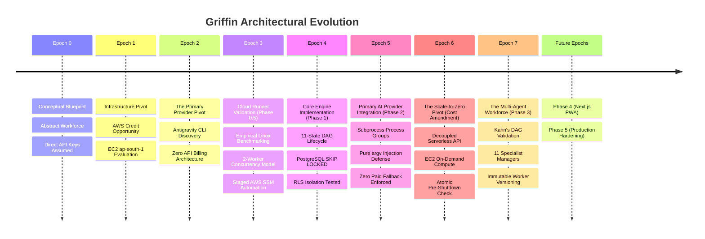

# Griffin Product & Architectural Evolution (evolution.md)

> *"No plan survives first contact with the compiler and the database. This document chronicles how Griffin actually changed from concept to implementation, the assumptions that failed, the pivots that succeeded, and the architectural shifts discovered while building."*

---

## 1. Timeline of Eras & Key Pivots

---

## 2. Detailed Chronicle of Changes

### Epoch 0: The Conceptual Blueprint (Theory)
- **Initial Assumption**: Griffin was conceived as an intelligent workforce with **JJ** as Chief of Staff and 11 specialist domain managers (Career, Research, Engineering, etc.). The initial assumption was that the system would call commercial model APIs (Google AI Studio, OpenAI, Anthropic) directly via REST endpoints using per-token billing, or run as a local CLI tool on the user's laptop.
- **The Reality Flaw**: 
  1. *Cost*: A continuous, autonomous 24/7 workforce performing multi-turn research, email drafting, code reviews, and periodic cron scans would burn hundreds of dollars per month in per-token API fees.
  2. *Availability*: A local CLI tool tethered execution to the user's laptop. If the laptop slept, closed, or lost Wi-Fi, background operations would halt.
- **Outcome**: The requirement became: **The cloud workforce must run 24/7 without requiring the laptop to stay online, but without accumulating per-token API bills.**

---

### Epoch 1: The AWS Credit Opportunity (Infrastructure Pivot)
- **What Changed**: The user identified that their personal AWS account had active promotional/free credits available.
- **The Evaluation**:
  - Investigated running a persistent virtual machine in **AWS Mumbai (`ap-south-1`)** to minimize network latency to Indian endpoints.
  - Audited Graviton2 ARM64 instances: `t4g.small` (2 GiB RAM, $8.28/mo), `t4g.medium` (4 GiB RAM, $16.35/mo), and `t4g.large` (8 GiB RAM, $32.70/mo).
  - Factored in encrypted `gp3` storage ($2.40/mo), IPv4 addressing, snapshots, and data transfer.
- **The Pivot**:
  - Deploy Griffin on **`t4g.medium`** during the promotional credit period (100% credit-eligible, net out-of-pocket: **$0.00**).
  - Architect a clean downscaling path to **`t4g.small`** ($10.68–$14.33/mo total) once credits expire.
  - Replace traditional public SSH (port 22) with **AWS Systems Manager (SSM) Session Manager**, closing all inbound administrative ports.

---

### Epoch 2: The Antigravity Primary Breakthrough (Provider Pivot)
- **The Critical Investigation**:
  - The user requested: *Can Griffin use the Google Antigravity CLI (`agy`) under my existing personal Antigravity subscription as its PRIMARY cloud reasoning engine instead of per-token API keys?*
- **What We Discovered in Official Documentation**:
  1. **Remote SSH OAuth Flow**: When `agy` runs in a remote, headless environment without a browser display, it prints an authorization URL. The user logs in via their laptop browser, copies an authorization code, and pastes it into the remote terminal.
  2. **Headless Execution**: Non-interactive prompts execute with `agy -p "prompt" --output-format json` using disk-cached credentials without prompting or hanging.
  3. **Context Resumption**: Multi-turn conversation history is maintained natively across independent process runs using `--conversation <id>`.
  4. **Strict Schemas**: `--json-schema` natively constrains LLM output to match typed Go domain structs.
- **The Massive Product Shift**:
  - **Antigravity CLI was promoted from a local dev utility to the PRIMARY cloud execution provider.**
  - Direct paid model APIs were disabled by default (`allow_paid_fallback = false`).
  - Griffin became a system that offers **unlimited agent reasoning under an existing fixed subscription**, completely eliminating API bills.

---

### Epoch 3: Phase 0.5 Cloud Runner Proof-of-Concept (Empirical Validation)
- **The Reality Check**: Before writing any Go code or provisioning cloud VMs, we tested whether `agy` actually performs as advertised on Linux.
- **Empirical Findings on Linux**:
  - **Peak Memory RSS**: A single `agy` subprocess consumes **~235 MiB RSS** (lightweight because neural inference happens remotely in Google's cloud).
  - **CPU Utilization**: Consumed **0.650 seconds** of CPU time across a 15-second run (**~4.3% CPU load**).
  - **Concurrency Safety**: Two parallel worker runs completed in 14.44s wall-clock with distinct conversation IDs and zero lockfile collisions.
  - **Memory Headroom**: On a 4 GiB `t4g.medium`, two concurrent workers consume ~470 MiB, leaving **>2.6 GiB (64%) free memory headroom**.
- **Guardrail Enforced**:
  - We verified that the local AWS credentials profile (`axiom-dev`) lacked EC2 permissions. In strict accordance with user rules, zero cloud resources were launched until explicit credentials and approvals are provided. Automated launch scripts were codified in [`infra/provision-ec2.sh`](infra/provision-ec2.sh) and [`infra/user-data.sh`](infra/user-data.sh).

---

### Epoch 4: Phase 1 Core Engine & Data Foundations (The Hard Truths of Building)
When we began writing Go code and SQL migrations in Phase 1, several assumptions from the initial architecture documents evolved:

#### 1. From 5 Naive States to 11 Explicit Lifecycle States
- *Original Plan*: Simple states (`PENDING`, `RUNNING`, `COMPLETED`, `FAILED`, `CANCELLED`).
- *The Problem*: In a distributed, asynchronous DAG engine, tasks wait for prerequisites, tasks pause for human approvals, tasks retry with exponential backoff, and tasks need output verification. Without explicit states, background workers and reapers race against each other.
- *The Evolution*: Introduced the full 11-state machine:
  `CREATED` $\rightarrow$ `ROUTED` $\rightarrow$ `QUEUED` $\rightarrow$ `RUNNING` $\rightarrow$ `WAITING_FOR_DEPENDENCY` $\rightarrow$ `VERIFYING` $\rightarrow$ `AWAITING_APPROVAL` $\rightarrow$ `RETRYING` $\rightarrow$ `COMPLETED` $\rightarrow$ `FAILED` $\rightarrow$ `CANCELLED`.

#### 2. The PostgreSQL Row Level Security (RLS) Superuser Trap
- *Original Plan*: Enable RLS on tables and assume `auth.uid() = user_id` handles tenant isolation.
- *The Discovery*: In PostgreSQL, superusers (such as the default `postgres` role) **silently bypass RLS policies**, even if `ENABLE ROW LEVEL SECURITY` is set!
- *The Evolution*: We added `FORCE ROW LEVEL SECURITY` across all tables, created an explicit non-superuser test role `griffin_test_user`, and verified in [`tests/rls_test.go`](tests/rls_test.go) that tenant isolation is strictly enforced at the database kernel level.

#### 3. Execution Attempt Tracking & Idempotent Upserts
- *Original Plan*: Insert a task attempt record when a task starts.
- *The Problem*: When a task completes or fails, inserting a second attempt row broke attempt counts and duplicated attempt history.
- *The Evolution*: Upgraded `task_attempts` to use atomic PostgreSQL upserts: `ON CONFLICT (id) DO UPDATE SET status = EXCLUDED.status, ...`, keeping start, heartbeat, duration, tokens, and errors in a single durable record per attempt.

#### 4. Package Decoupling (`httputil`)
- *Original Plan*: Keep HTTP response helpers inside `internal/api`.
- *The Problem*: Handlers in `internal/api/handlers` needed response helpers, but `internal/api/server.go` imported `handlers`, causing a Go circular package import cycle.
- *The Evolution*: Extracted response and error serialization into a dedicated [`internal/api/httputil`](internal/api/httputil/response.go) package, preserving clean directional dependency flow.

#### 5. Deterministic Mock Execution for Phase 1
- *Original Plan*: Some thought was given to stubbing CLI calls immediately.
- *The Problem*: Binding directly to external CLI binaries in Phase 1 would make database and queue engine unit tests flaky, slow, and dependent on network connectivity.
- *The Evolution*: Created a provider-neutral `TaskExecutor` interface and a deterministic [`MockExecutor`](internal/worker/mock_executor.go). This allowed testing 10 competing concurrent workers, lease timeouts, reaper recovery, and DAG unblocking in under 3 seconds with 100% determinism.

---

### Epoch 5: Phase 2 Antigravity Primary Execution Provider (The Subprocess Realities)
Integrating the real Google Antigravity CLI as Griffin's primary engine surfaced critical distributed systems realities:

#### 1. The Subprocess Zombie Problem & Process Group Isolation
- *The Issue*: When a task times out or is cancelled, calling `cmd.Process.Kill()` only kills the parent `agy` process PID. Any subagents, compilers, or child tool processes spawned by `agy` become orphan zombies attached to PID 1, consuming CPU and memory.
- *The Evolution*: Configured `cmd.SysProcAttr = &syscall.SysProcAttr{Setpgid: true}` to give every task attempt a dedicated process group. When terminating, Griffin sends `SIGTERM` to `-pgid`, waits a 5-second graceful window, and escalates to `SIGKILL` to `-pgid`, followed by `cmd.Wait()` to guarantee complete kernel reaping.

#### 2. Shell Injection Defense via Pure `argv` Tokens
- *The Issue*: Passing complex task goals, user prompts, and JSON schemas through shell wrappers (`bash -c`) introduces severe argument injection vulnerabilities when user text contains metacharacters (`"`, `;`, `$()`, `|`).
- *The Evolution*: Eliminated all shell wrappers. All executions assemble discrete argument slices (`[]string{"-p", prompt, "--output-format", "json", ...}`) passed directly to `execve` syscalls.

#### 3. Scratchpad Isolation & Path Traversal Rejection
- *The Issue*: Workers need dedicated filesystem directories to prevent concurrent tasks from overwriting temporary files, but malicious or corrupted task identifiers could attempt directory traversal (`../`).
- *The Evolution*: Implemented [`WorkspaceManager`](internal/provider/antigravity/workspace.go) with `filepath.Clean` validation, verifying target directories strictly reside within `WORKSPACE_ROOT`. Directory mode is restricted to `0700` and payload files to `0600`.

#### 4. The Zero-Paid-Fallback Enforcement
- *The Issue*: If the Antigravity session expires, standard agent frameworks often fall back to paid API keys, silently charging the user's credit card.
- *The Evolution*: Griffin strictly halts on `ErrAuthenticationRequired`. The worker marks the task failed with `retryable: false`, records an `AUTHENTICATION_REQUIRED` event in PostgreSQL `task_events`, and alerts the operator. No paid API fallback exists.

#### 5. Two-Tier Testing Strategy
- *The Issue*: Running tests against the real `agy` CLI requires external network calls and takes ~20 seconds per turn.
- *The Evolution*: Separated testing into fast hermetic mock subprocess tests (using temporary bash scripts) and an opt-in live integration probe (`TestAntigravityLiveIntegration`) gated behind `GRIFFIN_ENABLE_LIVE_AGY_TEST=true`.

---

### Epoch 6: The Scale-to-Zero Pivot (Cost & Architecture Amendment)
- **The Financial Reality**: Even with promotional credits on AWS, keeping a dedicated VM running 24/7 incurs continuous billing. Once credits expire, compute on `t4g.medium` costs ~$16.35/month. For a personal AI workforce that is actively executing tasks 1 to 2 hours per day, running 24/7 means paying for 22+ hours of idle CPU.
- **The Decision**: Griffin must scale to zero on demand. The EC2 VM stops during idle windows and starts automatically when runnable tasks appear.
- **The Distributed Systems Discoveries**:
  1. *Decoupled API Ingress*: The public REST API cannot reside solely on the stoppable EC2 VM, or users would experience connection failures whenever the runner is asleep. Ingress is decoupled into a lightweight serverless entrypoint, while EC2 acts as an ephemeral execution runner.
  2. *Cold Boots and 202 Accepted*: Booting an EC2 instance from stopped to running takes 30–45 seconds. Synchronous HTTP responses would time out. The API shifts to asynchronous ingestion: returning `202 Accepted` with `X-Runner-Status: WAKEUP_SIGNALED` within 20ms.
  3. *The AWS Stopping State Trap*: Calling AWS `ec2:StartInstances` while an instance is still in the `stopping` transitional state throws `InvalidInstanceState`. The wake-up controller implements debounced polling with exponential backoff until the runner reaches `stopped` before issuing `StartInstances`.
  4. *The Simultaneous Task Arrival Shutdown Race*: If a task arrives just as the idle shutdown monitor enters draining or prepares to call the shutdown syscall, naive systems stop the machine and starve the newly arrived task until an external trigger. Griffin introduces an **atomic pre-shutdown recheck**: `CountRunnableTasks` is queried immediately before shutdown. If any task arrived or the check fails, shutdown is aborted, workers resume, and the monitor resets to `ACTIVE`.
  5. *Periodic Cron Scans without VM Cron*: Because the VM sleeps, OS-level cron cannot be relied upon to trigger scheduled tasks. AWS EventBridge Scheduler triggers `POST /api/v1/scheduler/tick` on the ingress API every minute, waking the runner when cron tasks are ready.
- **The Outcome**: Compute costs drop by >90% (to ~$1.34/mo for 2hr/day workloads), bringing total operating costs (including encrypted storage) to ~$4.13/mo.

---

### Epoch 7: Phase 3 JJ Orchestrator, Manager Framework & Agent Factory (The Realities of Hierarchical Delegation)
Implementing the multi-agent orchestration layer surfaced key distributed systems insights:

#### 1. Kahn's Algorithm DAG Cycle Defense
- *The Issue*: When an LLM generates a multi-step task breakdown, it can easily create circular dependency references (e.g. `Task A` requires `Task B`, and `Task B` requires `Task A`). If persisted, these tasks remain permanently trapped in `WAITING_FOR_DEPENDENCY`, deadlocking the workflow.
- *The Evolution*: Integrated Kahn's topological sort algorithm into `domain.ValidatePlan`. Plans with cycles or dangling prerequisite keys are detected in memory and rejected (`domain.PlanStatusRejected`) before creating database records.

#### 2. Root Task vs Child Task Lease Duality
- *The Issue*: In Phase 1, `CompleteTask` and `FailTask` strictly enforced `WHERE id = $id AND leased_by = $worker_id`. However, the root task representing JJ's overall orchestration is not claimed or leased by an ephemeral background worker. When JJ attempted to complete or fail the root task, the query affected 0 rows because `leased_by` was NULL.
- *The Evolution*: Refined the SQL completion/failure predicate to `WHERE id = $3 AND (leased_by = $4 OR manager_domain = 'JJ')`. This preserved worker lease invariants for child tasks while granting JJ authoritative completion rights over root tasks.

#### 3. Interlocking Dependencies with Sensitive Approval Gates
- *The Issue*: A child task may both depend on an earlier prerequisite AND require human approval (e.g., code deployment depending on build passing). If approval unblocking transitions directly to `QUEUED`, it prematurely executes before prerequisites complete. If it waits for dependencies first, humans are asked to approve obsolete tasks if dependencies fail.
- *The Evolution*: Griffin establishes state precedence: tasks requiring approval start in `AWAITING_APPROVAL`. When the user approves, `RespondToApproval` inspects `task_dependencies`. If prerequisites are still running, the task moves to `WAITING_FOR_DEPENDENCY`; if all prerequisites are completed, it unblocks to `QUEUED`.

#### 4. Specialist Worker Versioned Immutability & Audit Trail
- *The Issue*: Prompts and schema definitions evolve rapidly. Mutating worker definitions in-place destroys historical reproducibility: re-inspecting an old task execution would show prompts that weren't present when the task actually ran.
- *The Evolution*: The Agent Factory treats worker updates as append-only: updating a worker creates a new database row with `version = version + 1`, preserving the entire historical lineage. Every mutation records an entry in `agent_factory_audits` with actor attribution, timestamp, and JSON diffs.

#### 5. Circular Package Import Neutralization
- *The Issue*: The JJ planner needed to invoke `worker.TaskExecutor` to prompt AI models for plans, while `worker` imported `service.TaskEngine`. This created a Go import cycle (`service` $\rightarrow$ `worker` $\rightarrow$ `service`).
- *The Evolution*: Defined a consumer-side `PlanExecutor` interface inside `internal/service/planner.go` and implemented an adapter in `internal/worker/plan_adapter.go`, eliminating the circular package dependency.

### Epoch 8: Phase 4 AWS S3 Object Storage Integration (The Realities of Cloud File Persistence)
Phase 4 grounded Griffin's document and artifact storage in enterprise cloud object storage:

#### 1. Abandoning Google Drive for Direct AWS S3
- *The Issue*: Initial blueprints contemplated using Google Drive folders for file exchange. In practice, third-party desktop sync daemons are fragile, lack programmatic transaction boundaries, cannot provide signed URLs, and require interactive desktop sessions.
- *The Evolution*: Explicitly eliminated Google Drive from the architecture in favor of native AWS S3. S3 integrates directly with EC2 IAM instance profiles (`GriffinEC2WorkerRole`), requires zero permanent credentials, and supports instant presigned access.

#### 2. Dual-Persistence Architecture & Compensating Saga
- *The Issue*: Storing file blobs directly in PostgreSQL degrades database performance and bloats backups. However, storing files in S3 and metadata in PostgreSQL risks inconsistent split-brain states if the database write fails after the S3 upload finishes.
- *The Evolution*: Griffin implemented a Dual-Persistence model governed by a Compensating Saga: the payload streams to S3 first; if the subsequent PostgreSQL metadata insert fails, `StorageService` issues an immediate compensating `DeleteObject` against S3 in a detached background context, preventing orphaned cloud data.

#### 3. Task-Scoped Hierarchy & Directory Traversal Sanitation
- *The Issue*: Ad-hoc object keys risk name collisions, unauthorized overwrites, and directory traversal vulnerabilities if filenames contain `../../`.
- *The Evolution*: Enforced deterministic partitioning: `tasks/{task_id}/outputs/{sanitized_filename}`. All filenames are sanitized with `filepath.Base` and space-normalized.

#### 4. Fail-Fast Credential Verification
- *The Issue*: The default AWS SDK credentials chain can silently fall back to anonymous requests if local profiles or IAM roles are misconfigured, leading to confusing runtime 403 errors or unintended public writes.
- *The Evolution*: `storage.LoadAWSConfig` calls `Credentials.Retrieve()` and checks `creds.HasKeys()`. If credentials cannot be loaded, the system immediately returns `ErrAuthenticationFailed` on initialization.

---

## 3. Product Vision & Architecture Comparison

| Architectural Dimension | Initial Concept (Day 1) | Phase 1 (Engine Core) | Phase 2 (Antigravity Primary) | Scale-to-Zero (Epoch 6) | Phase 3 (Multi-Agent Workforce) | Phase 4 (S3 Storage Integration) |
| :--- | :--- | :--- | :--- | :--- | :--- | :--- |
| **Compute Model** | Local Laptop or Cloud | Dedicated 24/7 EC2 VM | Dedicated 24/7 EC2 VM | On-Demand Scale-to-Zero EC2 | On-Demand Scale-to-Zero EC2 | **On-Demand Scale-to-Zero EC2** |
| **Ingress Availability** | Coupled to host | Coupled to host | Coupled to host | Decoupled Serverless Ingress | Decoupled Serverless Ingress | **Decoupled Serverless Ingress** |
| **File / Object Storage**| Google Drive Sync Folder | Ephemeral local disk | Isolated scratch directories | Ephemeral scratchpads | Ephemeral scratchpads | **AWS S3 + PostgreSQL Dual-Persistence** |
| **Object Access Control**| Google Drive permissions | None | Local permissions (`0700`) | Local permissions (`0700`) | Local permissions (`0700`) | **Private Buckets + Presigned URLs (15m)** |
| **Cross-System Saga** | None | N/A | N/A | N/A | N/A | **Compensating Delete Pattern** |
| **Orchestration Layer** | Single monolithic prompt | None (Raw Tasks) | None (Raw Tasks) | Task engine queue | JJ Orchestrator (8 stages) | **JJ Orchestrator (8 stages)** |
| **Domain Delegation** | Flat agent list | Static domain tags | Static domain tags | Static domain tags | 11 Specialist Managers | **11 Specialist Managers** |
| **Worker Definitions** | None | Ad-hoc task payloads | Ad-hoc task payloads | Ad-hoc task payloads | Agent Factory (Immutable) | **Agent Factory (Immutable)** |
| **AI Execution Engine** | Commercial Model API Keys | MockExecutor in Go | Antigravity CLI (`agy`) | Antigravity CLI (`agy`) Primary | Antigravity Primary + AI Planner | **Antigravity Primary + AI Planner** |
| **API Token Cost** | Pay-per-token ($$$/month) | $0.00 (Mock Engine) | $0.00 model token cost | $0.00 model token cost | $0.00 model token cost | **$0.00 model token cost (Personal Sub)** |
| **EC2 Compute Cost** | N/A | ~$16.35/mo (always-on) | ~$16.35/mo (always-on) | ~$1.34/mo (91.8% savings) | ~$1.34/mo (91.8% savings) | **~$1.34/mo (91.8% savings)** |

---

## 4. Key Lessons Learned for Future Phases

1. **Subscriptions beat per-token APIs for background agents**: Running an agent workforce on pay-per-token APIs creates anxiety around looping prompts, large context windows, and periodic cron jobs. Running against a fixed monthly subscription transforms background AI into an ambient utility.
2. **Subprocesses require process groups**: When controlling external agent CLIs, never kill raw PIDs. Always use process groups (`Setpgid`) and send negative signals (`-pgid`) to cleanly eradicate child tool processes.
3. **Never allow silent paid fallbacks**: AI systems must fail fast and halt when subscription credentials expire. Silent failover to paid API endpoints leads to unexpected bill shock.
4. **PostgreSQL is all the message broker you need for V1**: Standard PostgreSQL row-level locks (`SELECT ... FOR UPDATE SKIP LOCKED`) provide crash resilience, transactional safety, and sub-millisecond polling with zero extra infrastructure.
5. **Pure `argv` slices neutralize prompt injection attacks against host OS**: Treating LLM prompts as raw data tokens rather than shell arguments keeps the host OS safe from execution attacks.
6. **Scale-to-zero requires atomic double-checking before machine power-off**: In distributed on-demand compute, task arrival is asynchronous to shutdown timers. Never initiate a system stop without an atomic database recheck immediately before the power syscall; otherwise, tasks submitted during draining will starve until an external stimulus occurs.
7. **DAG plans must be validated topologically before database persistence**: Never trust LLMs to produce non-cyclic dependencies. Validate with Kahn's algorithm before creating task records to prevent silent workflow deadlocks.
---

### Epoch 9: Final Product Completion, Hardening, and Cloud Release Sprint

- **Trigger**: Completion of Phase 4 S3 object storage; requirement for an intuitive, remotely accessible, production-grade web management console, live cloud verification, and cloud execution deployment runbooks.
- **Shift**:
  - **From**: CLI and cURL only operator interaction.
  - **To**: Next.js 15 TypeScript PWA Web Console with 10 management screens, live S3 integration test against `ap-south-1`, CORS and JWT web authentication, and production runbooks.
- **Key Implementation Details**:
  - **Web Console in `web/`**: Built with Next.js 15, TypeScript, Tailwind CSS, Lucide icons, and PWA manifest. Features Executive Dashboard, JJ Orchestrator Workspace, Task DAG Hierarchy, Task Details & Logs Inspector, Approvals Governance Inbox, S3 Artifacts Browser, Workforce Directory (11 managers), System Health, Operator Login, and Responsive Mobile Drawer/Navbar.
  - **CORS & Web Auth**: Implemented `internal/api/middleware/cors.go` and `internal/api/handlers/auth.go` (`POST /api/v1/auth/login`) with automatic foreign-key user provisioning and signed Supabase JWT issuance.
  - **Live Cloud Verification**: Verified `tests/s3_live_test.go` directly against real AWS S3 bucket `griffin-artifacts-123456789012-ap-south-1` in `ap-south-1` using `griffin-bootstrap` credentials with zero errors.
  - **Deployment Runbooks**: Authored `docs/DEPLOYMENT_RUNBOOK.md` and `docs/ANTIGRAVITY_CLOUD_RUNNER.md` detailing unattended Antigravity CLI authentication, DBus user lingering sessions, and EventBridge Scheduler configurations.

---

### Epoch 10: Two Modes (2026-11-07)

- **Trigger**: The plan made the laptop a host (ADR-072), but `agy` was still the only brain and the EC2 the only fallback, which left the phone with no way to act when the laptop was off.
- **Shift**:
  - **From**: devices as workers of one cloud brain, laptop first, phone driven only through the laptop.
  - **To**: brain and hands as separate ideas. The laptop is brain and hands when live; otherwise a text-only EC2 `agy` is the brain and an Android phone host is the hands.
- **What surfaced while writing it**: (1) skipping the agent's permission prompts on the laptop and offering a permission dashboard are contradictory unless enforcement moves below the agent, so the bypass-flag rejection of ADR-049/063 was narrowed, not dropped; (2) a dashboard served from the laptop fails exactly when phone mode is needed, so policy lives in the cloud; (3) UI automation through a cold `agy` per tap is too slow, so skill replay moved from nice-to-have to required; (4) a send interrupted by a device dropping must not be retried automatically.
- **What surfaced while building M2**: (5) presence cannot live on an `agents` row, so hosts got their own table; (6) the first host must not advertise what it cannot do: a host that claims `browser` without a browser would be handed steps it answers as plain text, the same false-completion failure the runner had in ADR-049, so the binary refuses unbacked capabilities; (7) work done by a host must not keep the cloud runner awake, which meant changing the runnable count, not just the wake call; (8) a host that is shut down mid-step must not mark the step failed, it must let the lease expire; (9) tests that use a superuser pool do not exercise row-level security, so the host routes were also run under the production roles.
- **Deploy without a laptop (2026-11-07)**: the owner asked to redeploy from the AWS console. Findings that shaped it: the master-only check had to live in the build's inline step (a check inside the repo could be edited away by the commit being deployed); the redeploy role must not be able to change the Lambda's configuration, so a feature flag (`HOSTS_ENABLED`) stays a manual console edit; the schema has to be expanded before the new binary starts or the server refuses to start; and a safety check is only worth having if a test shows it can fail, so the sandbox self-test is tested against a fake sandbox that isolates nothing.
- **Permissions (2026-11-07)**: writing the engine showed three things the plan had glossed. (1) With "most specific rule wins", an app-level "allow" must be narrower than a class-level "ask" or it loses; so the dashboard writes app and contact rules as app+send and contact+send. (2) "Never" has to win ties, otherwise a broad allow can undo a narrow block. (3) A host that has not yet received the policy must deny, not fall back to a default, because the owner may have switched reading off. Also: the policy has no consumer until hands exist, so the honest status is "enforced by nothing in production yet", and the docs say so.

---

### Epoch 11: Hands (2026-11-08)

- **Trigger**: the owner's end goal: reach WhatsApp and other apps from the phone or the laptop, whichever suits the job, and have workers for ordinary things like web search. The permission engine had no tool that called it.
- **Shift**:
  - **From**: hosts that only run text steps and fail anything that needs the owner's say-so.
  - **To**: hosts with hands. Each capability a step requires decides the device: files, browser and shell are the laptop's; phone apps are the phone's; WhatsApp and the web work from either and prefer the laptop.
- **What surfaced while building it**: (1) an approval has to be bound to the exact action (a digest of recipient and text), or one yes could cover a different message; (2) "try the other driver" is only safe before anything is sent, so failure after the send is a hard stop rather than a fallback; (3) the planner's first draft read "Google Antigravity" in an ordinary research request as a search command, which the existing integration test caught, so "google" now counts only as a command at the start of a request; (4) the first browser cleanup returned before Chrome had exited, which would have kept the WhatsApp profile locked for the next job; the test suite's temp-folder cleanup exposed it; (5) an action a model composed from text is not what the owner intended unless the owner's own words named that person.
- **Honest status**: everything is verified against stand-ins (a fake WhatsApp page in a real browser, a fake phone, a fake search engine). The first run on the owner's real account, phone and search provider is a guided check, not an assumption.

