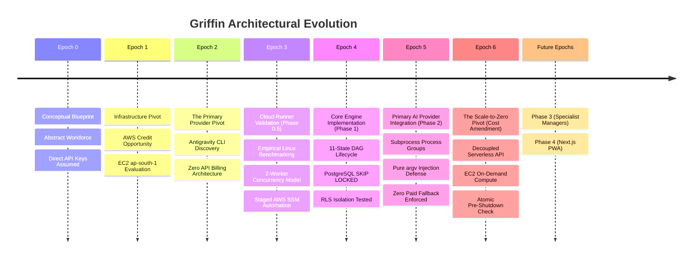

# Griffin Product & Architectural Evolution (evolution.md)

> *"No plan survives first contact with the compiler and the database. This document chronicles how Griffin actually changed from concept to implementation, the assumptions that failed, the pivots that succeeded, and the architectural shifts discovered while building."*

---

## 1. Timeline of Eras & Key Pivots

---

## 2. Detailed Chronicle of Changes

### Epoch 0: The Conceptual Blueprint (Theory)
- **Initial Assumption**: Griffin was conceived as an intelligent workforce with **JJ** as Chief of Staff and 11 specialist domain managers (Career, Research, Engineering, etc.). The initial assumption was that the system would call commercial model APIs (Google AI Studio, OpenAI, Anthropic) directly via REST endpoints using per-token billing, or run as a local CLI tool on the user's laptop.
- **The Reality Flaw**: 
  1. *Cost*: A continuous, autonomous 24/7 workforce performing multi-turn research, email drafting, code reviews, and periodic cron scans would burn hundreds of dollars per month in per-token API fees.
  2. *Availability*: A local CLI tool tethered execution to the user's laptop. If the laptop slept, closed, or lost Wi-Fi, background operations would halt.
- **Outcome**: The requirement became: **The cloud workforce must run 24/7 without requiring the laptop to stay online, but without accumulating per-token API bills.**

---

### Epoch 1: The AWS Credit Opportunity (Infrastructure Pivot)
- **What Changed**: The user identified that their personal AWS account had active promotional/free credits available.
- **The Evaluation**:
  - Investigated running a persistent virtual machine in **AWS Mumbai (`ap-south-1`)** to minimize network latency to Indian endpoints.
  - Audited Graviton2 ARM64 instances: `t4g.small` (2 GiB RAM, $8.28/mo), `t4g.medium` (4 GiB RAM, $16.35/mo), and `t4g.large` (8 GiB RAM, $32.70/mo).
  - Factored in encrypted `gp3` storage ($2.40/mo), IPv4 addressing, snapshots, and data transfer.
- **The Pivot**:
  - Deploy Griffin on **`t4g.medium`** during the promotional credit period (100% credit-eligible, net out-of-pocket: **$0.00**).
  - Architect a clean downscaling path to **`t4g.small`** ($10.68–$14.33/mo total) once credits expire.
  - Replace traditional public SSH (port 22) with **AWS Systems Manager (SSM) Session Manager**, closing all inbound administrative ports.

---

### Epoch 2: The Antigravity Primary Breakthrough (Provider Pivot)
- **The Critical Investigation**:
  - The user requested: *Can Griffin use the Google Antigravity CLI (`agy`) under my existing personal Antigravity subscription as its PRIMARY cloud reasoning engine instead of per-token API keys?*
- **What We Discovered in Official Documentation**:
  1. **Remote SSH OAuth Flow**: When `agy` runs in a remote, headless environment without a browser display, it prints an authorization URL. The user logs in via their laptop browser, copies an authorization code, and pastes it into the remote terminal.
  2. **Headless Execution**: Non-interactive prompts execute with `agy -p "prompt" --output-format json` using disk-cached credentials without prompting or hanging.
  3. **Context Resumption**: Multi-turn conversation history is maintained natively across independent process runs using `--conversation <id>`.
  4. **Strict Schemas**: `--json-schema` natively constrains LLM output to match typed Go domain structs.
- **The Massive Product Shift**:
  - **Antigravity CLI was promoted from a local dev utility to the PRIMARY cloud execution provider.**
  - Direct paid model APIs were disabled by default (`allow_paid_fallback = false`).
  - Griffin became a system that offers **unlimited agent reasoning under an existing fixed subscription**, completely eliminating API bills.

---

### Epoch 3: Phase 0.5 Cloud Runner Proof-of-Concept (Empirical Validation)
- **The Reality Check**: Before writing any Go code or provisioning cloud VMs, we tested whether `agy` actually performs as advertised on Linux.
- **Empirical Findings on Linux**:
  - **Peak Memory RSS**: A single `agy` subprocess consumes **~235 MiB RSS** (lightweight because neural inference happens remotely in Google's cloud).
  - **CPU Utilization**: Consumed **0.650 seconds** of CPU time across a 15-second run (**~4.3% CPU load**).
  - **Concurrency Safety**: Two parallel worker runs completed in 14.44s wall-clock with distinct conversation IDs and zero lockfile collisions.
  - **Memory Headroom**: On a 4 GiB `t4g.medium`, two concurrent workers consume ~470 MiB, leaving **>2.6 GiB (64%) free memory headroom**.
- **Guardrail Enforced**:
  - We verified that the local AWS credentials profile (`axiom-dev`) lacked EC2 permissions. In strict accordance with user rules, zero cloud resources were launched until explicit credentials and approvals are provided. Automated launch scripts were codified in [`infra/provision-ec2.sh`](infra/provision-ec2.sh) and [`infra/user-data.sh`](infra/user-data.sh).

---

### Epoch 4: Phase 1 Core Engine & Data Foundations (The Hard Truths of Building)
When we began writing Go code and SQL migrations in Phase 1, several assumptions from the initial architecture documents evolved:

#### 1. From 5 Naive States to 11 Explicit Lifecycle States
- *Original Plan*: Simple states (`PENDING`, `RUNNING`, `COMPLETED`, `FAILED`, `CANCELLED`).
- *The Problem*: In a distributed, asynchronous DAG engine, tasks wait for prerequisites, tasks pause for human approvals, tasks retry with exponential backoff, and tasks need output verification. Without explicit states, background workers and reapers race against each other.
- *The Evolution*: Introduced the full 11-state machine:
  `CREATED` $\rightarrow$ `ROUTED` $\rightarrow$ `QUEUED` $\rightarrow$ `RUNNING` $\rightarrow$ `WAITING_FOR_DEPENDENCY` $\rightarrow$ `VERIFYING` $\rightarrow$ `AWAITING_APPROVAL` $\rightarrow$ `RETRYING` $\rightarrow$ `COMPLETED` $\rightarrow$ `FAILED` $\rightarrow$ `CANCELLED`.

#### 2. The PostgreSQL Row Level Security (RLS) Superuser Trap
- *Original Plan*: Enable RLS on tables and assume `auth.uid() = user_id` handles tenant isolation.
- *The Discovery*: In PostgreSQL, superusers (such as the default `postgres` role) **silently bypass RLS policies**, even if `ENABLE ROW LEVEL SECURITY` is set!
- *The Evolution*: We added `FORCE ROW LEVEL SECURITY` across all tables, created an explicit non-superuser test role `griffin_test_user`, and verified in [`tests/rls_test.go`](tests/rls_test.go) that tenant isolation is strictly enforced at the database kernel level.

#### 3. Execution Attempt Tracking & Idempotent Upserts
- *Original Plan*: Insert a task attempt record when a task starts.
- *The Problem*: When a task completes or fails, inserting a second attempt row broke attempt counts and duplicated attempt history.
- *The Evolution*: Upgraded `task_attempts` to use atomic PostgreSQL upserts: `ON CONFLICT (id) DO UPDATE SET status = EXCLUDED.status, ...`, keeping start, heartbeat, duration, tokens, and errors in a single durable record per attempt.

#### 4. Package Decoupling (`httputil`)
- *Original Plan*: Keep HTTP response helpers inside `internal/api`.
- *The Problem*: Handlers in `internal/api/handlers` needed response helpers, but `internal/api/server.go` imported `handlers`, causing a Go circular package import cycle.
- *The Evolution*: Extracted response and error serialization into a dedicated [`internal/api/httputil`](internal/api/httputil/response.go) package, preserving clean directional dependency flow.

#### 5. Deterministic Mock Execution for Phase 1
- *Original Plan*: Some thought was given to stubbing CLI calls immediately.
- *The Problem*: Binding directly to external CLI binaries in Phase 1 would make database and queue engine unit tests flaky, slow, and dependent on network connectivity.
- *The Evolution*: Created a provider-neutral `TaskExecutor` interface and a deterministic [`MockExecutor`](internal/worker/mock_executor.go). This allowed testing 10 competing concurrent workers, lease timeouts, reaper recovery, and DAG unblocking in under 3 seconds with 100% determinism.

---

### Epoch 5: Phase 2 Antigravity Primary Execution Provider (The Subprocess Realities)
Integrating the real Google Antigravity CLI as Griffin's primary engine surfaced critical distributed systems realities:

#### 1. The Subprocess Zombie Problem & Process Group Isolation
- *The Issue*: When a task times out or is cancelled, calling `cmd.Process.Kill()` only kills the parent `agy` process PID. Any subagents, compilers, or child tool processes spawned by `agy` become orphan zombies attached to PID 1, consuming CPU and memory.
- *The Evolution*: Configured `cmd.SysProcAttr = &syscall.SysProcAttr{Setpgid: true}` to give every task attempt a dedicated process group. When terminating, Griffin sends `SIGTERM` to `-pgid`, waits a 5-second graceful window, and escalates to `SIGKILL` to `-pgid`, followed by `cmd.Wait()` to guarantee complete kernel reaping.

#### 2. Shell Injection Defense via Pure `argv` Tokens
- *The Issue*: Passing complex task goals, user prompts, and JSON schemas through shell wrappers (`bash -c`) introduces severe argument injection vulnerabilities when user text contains metacharacters (`"`, `;`, `$()`, `|`).
- *The Evolution*: Eliminated all shell wrappers. All executions assemble discrete argument slices (`[]string{"-p", prompt, "--output-format", "json", ...}`) passed directly to `execve` syscalls.

#### 3. Scratchpad Isolation & Path Traversal Rejection
- *The Issue*: Workers need dedicated filesystem directories to prevent concurrent tasks from overwriting temporary files, but malicious or corrupted task identifiers could attempt directory traversal (`../`).
- *The Evolution*: Implemented [`WorkspaceManager`](internal/provider/antigravity/workspace.go) with `filepath.Clean` validation, verifying target directories strictly reside within `WORKSPACE_ROOT`. Directory mode is restricted to `0700` and payload files to `0600`.

#### 4. The Zero-Paid-Fallback Enforcement
- *The Issue*: If the Antigravity session expires, standard agent frameworks often fall back to paid API keys, silently charging the user's credit card.
- *The Evolution*: Griffin strictly halts on `ErrAuthenticationRequired`. The worker marks the task failed with `retryable: false`, records an `AUTHENTICATION_REQUIRED` event in PostgreSQL `task_events`, and alerts the operator. No paid API fallback exists.

#### 5. Two-Tier Testing Strategy
- *The Issue*: Running tests against the real `agy` CLI requires external network calls and takes ~20 seconds per turn.
- *The Evolution*: Separated testing into fast hermetic mock subprocess tests (using temporary bash scripts) and an opt-in live integration probe (`TestAntigravityLiveIntegration`) gated behind `GRIFFIN_ENABLE_LIVE_AGY_TEST=true`.

---

### Epoch 6: The Scale-to-Zero Pivot (Cost & Architecture Amendment)
- **The Financial Reality**: Even with promotional credits on AWS, keeping a dedicated VM running 24/7 incurs continuous billing. Once credits expire, compute on `t4g.medium` costs ~$16.35/month. For a personal AI workforce that is actively executing tasks 1 to 2 hours per day, running 24/7 means paying for 22+ hours of idle CPU.
- **The Decision**: Griffin must scale to zero on demand. The EC2 VM stops during idle windows and starts automatically when runnable tasks appear.
- **The Distributed Systems Discoveries**:
  1. *Decoupled API Ingress*: The public REST API cannot reside solely on the stoppable EC2 VM, or users would experience connection failures whenever the runner is asleep. Ingress is decoupled into a lightweight serverless entrypoint, while EC2 acts as an ephemeral execution runner.
  2. *Cold Boots and 202 Accepted*: Booting an EC2 instance from stopped to running takes 30–45 seconds. Synchronous HTTP responses would time out. The API shifts to asynchronous ingestion: returning `202 Accepted` with `X-Runner-Status: WAKEUP_SIGNALED` within 20ms.
  3. *The AWS Stopping State Trap*: Calling AWS `ec2:StartInstances` while an instance is still in the `stopping` transitional state throws `InvalidInstanceState`. The wake-up controller implements debounced polling with exponential backoff until the runner reaches `stopped` before issuing `StartInstances`.
  4. *The Simultaneous Task Arrival Shutdown Race*: If a task arrives just as the idle shutdown monitor enters draining or prepares to call the shutdown syscall, naive systems stop the machine and starve the newly arrived task until an external trigger. Griffin introduces an **atomic pre-shutdown recheck**: `CountRunnableTasks` is queried immediately before shutdown. If any task arrived or the check fails, shutdown is aborted, workers resume, and the monitor resets to `ACTIVE`.
  5. *Periodic Cron Scans without VM Cron*: Because the VM sleeps, OS-level cron cannot be relied upon to trigger scheduled tasks. AWS EventBridge Scheduler triggers `POST /api/v1/scheduler/tick` on the ingress API every minute, waking the runner when cron tasks are ready.
- **The Outcome**: Compute costs drop by >90% (to ~$1.34/mo for 2hr/day workloads), bringing total operating costs (including encrypted storage) to ~$4.13/mo.

---

## 3. Product Vision & Architecture Comparison

| Architectural Dimension | Initial Concept (Day 1) | Phase 1 (Engine Core) | Phase 2 (Antigravity Primary) | Current Built Reality (Scale-to-Zero) |
| :--- | :--- | :--- | :--- | :--- |
| **Compute Model** | Local Laptop or Cloud | Dedicated 24/7 EC2 VM | Dedicated 24/7 EC2 VM | **On-Demand Scale-to-Zero EC2 Runner** |
| **Ingress Availability** | Coupled to host | Coupled to host | Coupled to host | **Decoupled Serverless / Always-On Ingress** |
| **Task Ingestion Semantics**| Synchronous | Synchronous 201 Created | Synchronous 201 Created | **Asynchronous 202 Accepted on Sleep** |
| **AI Execution Engine** | Commercial Model API Keys | MockExecutor in Go | Antigravity CLI (`agy`) | **Antigravity CLI (`agy`) Primary** |
| **API Token Cost** | Pay-per-token ($$$/month) | $0.00 (Mock Engine) | $0.00 model token cost | **$0.00 model token cost (Personal Sub)** |
| **EC2 Compute Cost** | N/A | ~$16.35/mo (always-on) | ~$16.35/mo (always-on) | **~$1.34/mo (91.8% savings on 2hr/day)** |
| **Subprocess Containment**| None | Abstract provider contract | `Setpgid: true`, Process Groups | **`Setpgid: true`, Process Groups** |
| **Shutdown Race Handling**| None | None | Graceful OS shutdown | **Atomic Pre-Shutdown DB Recheck** |
| **Task Queue** | Abstract / Redis | PostgreSQL 17 `SKIP LOCKED` | PostgreSQL 17 `SKIP LOCKED` | **Native PostgreSQL 17 `SKIP LOCKED`** |
| **Task States** | 5 simple states | 11 robust states | 11 robust states with DAG | **11 robust states with DAG** |
| **Worker Concurrency** | Unbounded | 2 workers configured | 2-worker bounded pool | **2-worker bounded pool + Draining** |
| **Testing Strategy** | Manual runs | Mock unit & integration | Two-Tier (Hermetic + Live) | **Two-Tier + Scale-to-Zero State Machine Suite** |

---

## 4. Key Lessons Learned for Future Phases

1. **Subscriptions beat per-token APIs for background agents**: Running an agent workforce on pay-per-token APIs creates anxiety around looping prompts, large context windows, and periodic cron jobs. Running against a fixed monthly subscription transforms background AI into an ambient utility.
2. **Subprocesses require process groups**: When controlling external agent CLIs, never kill raw PIDs. Always use process groups (`Setpgid`) and send negative signals (`-pgid`) to cleanly eradicate child tool processes.
3. **Never allow silent paid fallbacks**: AI systems must fail fast and halt when subscription credentials expire. Silent failover to paid API endpoints leads to unexpected bill shock.
4. **PostgreSQL is all the message broker you need for V1**: Standard PostgreSQL row-level locks (`SELECT ... FOR UPDATE SKIP LOCKED`) provide crash resilience, transactional safety, and sub-millisecond polling with zero extra infrastructure.
5. **Pure `argv` slices neutralize prompt injection attacks against host OS**: Treating LLM prompts as raw data tokens rather than shell arguments keeps the host OS safe from execution attacks.
6. **Scale-to-zero requires atomic double-checking before machine power-off**: In distributed on-demand compute, task arrival is asynchronous to shutdown timers. Never initiate a system stop without an atomic database recheck immediately before the power syscall; otherwise, tasks submitted during draining will starve until an external stimulus occurs.

